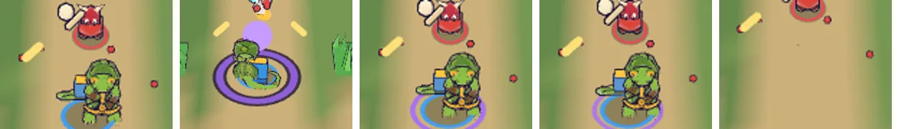

# 85회차: 전투 손맛, 영웅 발밑의 필살 준비 표시

| 항목 | 값 |
| --- | --- |
| 시각 | 2026-11-13 11:42 ~ 11:52 KST (예약 회차) |
| 기준 | `a5ba7a7` (main `f72adce` + 70~84회차) |
| 레인 | 전투 손맛 (열린 항목 없음, 67·80회차 신호 점검에서 고름) |
| 상태 | 완료 |
| 다음 레인 | 렌더 톤·모델 |

## 문제

필살기가 준비되면 지금 신호는 셋이다.
- 소리 ‘freeze’
- 화면 오른쪽 아래 필살 단추의 보라 맥동
- ‘필살기 준비 완료!’ 알림 글. #107 결정으로 숨겨져 있다.

전투 중 눈은 영웅과 적에 가 있다. 그래서 구석 단추의 변화는 놓치기 쉽다. 브롤스타즈식 문법에서는 필살이 차면 **캐릭터 발밑 원 자체**가 빛난다. 러시의 영웅 발밑에는 아군 파랑 고리(`allyRing`)만 있고, 필살 상태는 월드에 보이지 않는다.

## 범위

- **준비 고리**: 필살이 준비된 동안 영웅 발밑 파랑 고리 바깥에 필살 보라(`PAL.super`) 고리를 두른다. 0.9초 주기로 숨 쉬듯 커졌다 작아진다(단추 맥동과 같은 박자). 동작 줄이기에서는 맥동 없이 고정이다. 필살을 쓰거나 영웅이 쓰러지면 사라진다.
- **차오르는 순간**: `superReady` 사건에 영웅 자리에서 보라 잉크 고리가 한 번 퍼진다(기존 `ring` 효과).
- 글은 쓰지 않는다(#107). 바꾸는 파일은 `render.ts`.

## 가설

휴대폰 가로 전투 화면에서 영웅을 보는 눈으로 필살 준비를 알 수 있다. 보라는 아군 파랑, 적 빨강, 골드 동전과 겹치지 않는 색이라 다른 신호와 헷갈리지 않는다. 드로콜은 준비된 동안만 +1이다.

## 수용 기준

- [x] 실제 시연 전투에서 차오르기 전·차오른 순간(퍼지는 고리)·준비 중·쓴 뒤 스크린샷 직접 확인(휴대폰 가로)
- [x] 덤불 속·쓰러짐에서 고리가 사라지거나 알맞게 보이는지 확인
- [x] `test:rush`, `tsc`, `build`, `smoke:rush` 통과

## 결과

가설이 맞았다. 필살이 차면 영웅 발밑 파랑 고리 바깥에 보라 고리가 생기고, 숨 쉬듯 맥동한다. 차오르는 순간에는 보라 잉크 고리가 한 번 퍼진다. 글은 없다.

**모양** (`render.ts`)

- 준비 고리
  - 필살 보라(`PAL.super`) 고리이고, 반지름은 0.82~0.95다(파랑 고리 0.59~0.72 바깥, 사이에 틈이 있음).
  - 0.9초 주기로 크기 ±7%, 투명도 0.69~0.95로 맥동한다(단추 맥동과 같은 박자). 동작 줄이기에서는 고정이다.
  - 다른 발밑 장식처럼 지형 높이에 맞춘다(`conformDecal`). 준비된 동안만 메시 1개(드로콜 +1)가 그려진다.
- 차오르는 순간: `superReady` 사건에 영웅 자리에서 반지름 2.4 보라 잉크 고리가 0.5초 퍼진다(기존 `ring` 효과).
- 필살을 쓰거나 영웅이 쓰러지면 고리가 바로 사라진다.

**확인** (휴대폰 가로, 직접 봄)

- 실제 시연 전투
  - 충전 중(6/12)에는 고리가 없다.
  - 12/12가 되는 프레임에 보라 잉크 고리가 퍼진다.
  - 궁수 봇은 필살을 금방 쓴다. 다음 화면에서는 이미 쏜 뒤(청록 필살 화살)라 고리가 없다.
- 멈춘 전투(같은 순간, 충전만 바꿈)
  - 충전 0이면 없음, 12이면 보라 고리가 있다. 0.45초 간격 두 장에서 크기가 다르다(맥동).
  - 쓰러짐으로 바꾸면 영웅과 고리가 함께 사라지고, 부활 원판(80회차)만 남는다.
- 보라는 아군 파랑, 적 빨강 고리, 골드 동전, 회복 초록과 섞이지 않는다.

## 검증

- `npm run test:rush`: 105개 통과(규칙 변경 없음).
- `npx tsc --noEmit`, `npm run build`: 통과.
- `npm run smoke:rush`: 33/33 통과.

## 다음

- **다음 레인: 렌더 톤·모델.** 열린 렌더 항목이 없어 다음 회차에 고른다. 보호막 주술사(37)를 넣으면 막 껍질·깨짐 표시가 그 회차 몫이 된다.
- 백로그 상위 3개
  1. (PvE 콘텐츠) 보호막 주술사 M(무리 전체 + 근접 넓게 깨기) 넣기, 진행 시험 먼저(37)
  2. (성능·모바일) 영웅 GLB 2단계: 계약 시험을 정규화 읽기로 바꾸고 meshopt(47, 생산 쪽 결정)
  3. (엔진 스파이크) 숲 마을 외곽선 껍질 부품별 단순화 시험(46)
