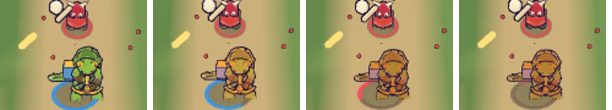

# 86회차: 렌더 톤·모델, 발밑 고리로 보이는 영웅 체력

| 항목 | 값 |
| --- | --- |
| 시각 | 2026-11-13 12:42 ~ 12:55 KST (예약 회차) |
| 기준 | `2a988f2` (main `f72adce` + 70~85회차) |
| 레인 | 렌더 톤·모델 (열린 항목 없음, 80·85회차 신호 점검의 남은 빈칸에서 고름) |
| 상태 | **채택 안 함, 되돌림** (기존 #107 체력 신호와 겹치고 그 결정에 어긋남. 저장소 변경은 기록뿐) |
| 다음 레인 | 성능·모바일 |

## 문제

#107이 머리 위 체력 막대를 숨겼다(`heroBar.root.visible = false`). 전투 중 내 영웅의 체력을 알 방법이 없다.
- 맞을 때 영웅 재질이 맥동하지만(#111) 남은 양은 알려 주지 않는다.
- 쓰러지기 직전인지 몰라서 ‘물러설 때’를 판단할 수 없다. 브롤스타즈식 전투에서 가장 기본인 판단이다.

#107의 방향(막대·숫자 없이 깔끔하게)은 지키면서, 체력을 월드 안의 모양으로 보이고 싶다.

## 범위

- **발밑 파랑 고리를 체력 호로 바꾼다.**
  - 체력이 가득이면 지금과 같은 온전한 고리다. 줄어든 만큼 12시부터 비어 간다.
  - 빈 자리에는 어두운 잉크 바탕 고리가 보여, 얼마나 잃었는지 읽힌다.
  - 호는 고리 기하 하나에 그리기 범위(`drawRange`)만 바꿔 그린다. 마디 48칸이고, 매 프레임 기하를 새로 만들지 않는다. 지형 맞춤(`conformDecal`)은 그대로 쓴다.
- **위기**: 체력 35% 이하에서 호가 빨강으로 바뀌고 0.6초 주기로 깜빡인다. 동작 줄이기에서는 깜빡임 없이 빨강만 쓴다.
- 85회차 보라 필살 고리는 바깥에 그대로 둔다.
- 글·숫자·막대는 쓰지 않는다. 바꾸는 파일은 `render.ts`.

## 가설

휴대폰 가로 전투 크기에서도 고리의 빈 몫이 읽힌다(가득·절반·위기 구별). 팀 표시는 여전히 파랑 고리라서 아군 읽기는 그대로다. 드로콜은 바탕 고리만큼 +1이다.

## 수용 기준

- [x] 멈춘 전투에서 체력 100%·60%·30%(위기)·10% 스크린샷 직접 확인(휴대폰 가로, 데스크톱)
- [ ] 실제 시연 전투에서 맞은 뒤 호가 줄어드는 것 확인 (채택하지 않아 하지 않음)
- [x] `test:rush`, `tsc`, `build`, `smoke:rush` 통과

## 결과

**문제 진단이 틀렸다. 그래서 채택하지 않고 되돌렸다.**

시도 자체는 동작했다.
- 고리는 체력만큼 줄고, 35% 아래에서 빨강으로 깜빡였다(휴대폰 가로·데스크톱 멈춘 전투, 100·60·30·10%).
- 휴대폰 가로 크기에서도 빈 몫이 읽혔다.

그런데 스크린샷에서 영웅 모델 색도 체력에 따라 바뀌는 것이 보여 코드를 확인했다. **#107(`6612cf8`)이 이미 막대 없이 체력을 보이는 장치를 만들어 두었다.**

| 체력 | 단계 | 영웅에 보이는 것 (`townDamage.ts`, `render.ts` `syncDamage`) |
| --- | --- | --- |
| 65% 초과 | 건강 | 그대로 |
| 65% 이하 | 상처 | 재질이 어두워짐(곱하기 색 `0xc9c4be`), 몸이 4% 눌림 |
| 30% 이하 | 위기 | 더 어두워짐(`0x9d9690`), 몸이 10% 눌림 (연기는 마을에만 나고 영웅에는 없음) |
| 맞을 때 | | 주황 발광 맥동 0.22초(초당 1.25번까지) |

- 그 코드의 주석은 ‘**체력 HUD를 더하지 않고** 재질·자세로 읽히는 월드 신호’라고 적고 있다. 체력을 정확한 양으로 보이지 않는 것도 의도된 선택이다.
- 체력 호는 월드 안에 그리지만, 실제로는 정확한 양을 보이는 체력 계기다. 이미 있는 단계 신호와 겹치고, #107 결정(체력 HUD 없음)에 어긋난다. 그래서 넣지 않았다.
- 80·85회차의 점검 표에도 이 단계 신호가 빠져 있었다. 그 표의 ‘영웅 피격: 재질 맥동’ 칸은 ‘재질 맥동 + 체력 단계(어두워짐·눌림)’로 읽어야 한다.

## 배운 것

- 신호 빈칸을 찾을 때는 `main.ts`의 사건 처리만 보지 말고 `render.ts`의 상태 동기화(`syncDamage` 같은 읽기 전용 신호)도 함께 읽는다.
- #107·#111이 남긴 ‘HUD 없음’ 결정은 막대·글자만이 아니라 **정확한 수치 계기 전체**를 피하는 쪽으로 읽는다.

## 검증

- 시도 코드(`render.ts`)는 되돌렸다(`git checkout`). 저장소 변경은 기록과 그림뿐이다.
- `npm run test:rush`: 105개 통과.
- `npx tsc --noEmit`, `npm run build`: 통과.
- `npm run smoke:rush`: 33/33 통과.

## 다음

- **다음 레인: 성능·모바일.**
- 백로그 상위 3개
  1. (PvE 콘텐츠) 보호막 주술사 M(무리 전체 + 근접 넓게 깨기) 넣기, 진행 시험 먼저(37)
  2. (성능·모바일) 영웅 GLB 2단계: 계약 시험을 정규화 읽기로 바꾸고 meshopt(47, 생산 쪽 결정)
  3. (엔진 스파이크) 숲 마을 외곽선 껍질 부품별 단순화 시험(46)
