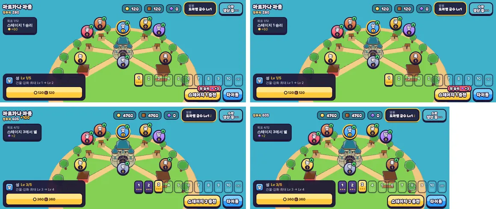

# 87회차: 성능·모바일, 마을 화면을 바뀔 때만 다시 그리기

| 항목 | 값 |
| --- | --- |
| 시각 | 2026-11-13 13:42 ~ 13:58 KST (예약 회차) |
| 기준 | `7879644` (main `f72adce` + 70~86회차) |
| 레인 | 성능·모바일 (47 2단계는 생산 쪽 결정이 먼저라 새 항목을 고름) |
| 상태 | 완료 |
| 다음 레인 | 엔진 스파이크 |

## 문제

마을 화면(`main.ts` 484~493행)은 섬 장면을 **매 프레임** 다시 그린다. 그런데 섬은 거의 멈춰 있다.
- 움직이는 것은 건물을 올렸을 때의 0.45초 튀어 오름(`townView.update`의 `pop`)뿐이다.
- 표지·막대·목표 칸은 DOM이라 3D를 다시 그리지 않아도 움직인다(CSS 애니메이션).
- 숲 마을 모델에는 애니메이션이 없다(믹서 없음).

킹샷식 게임에서는 마을 화면에 오래 머문다. 그래서 멈춘 그림을 초당 60번 그리는 것은 휴대폰 배터리·발열 비용이다. 30회차는 같은 이유로 메뉴(타이틀·결과·일시정지)를 **4프레임에 한 번** 그리게 했지만, 마을은 그 규칙 밖이다.

## 범위

- **마을도 4프레임에 한 번 그린다.** 다음 경우에는 바로 그린다.
  - 마을에 들어온 첫 프레임
  - 창 크기 바뀜·품질 바뀜. 캔버스가 지워지므로 30회차의 `forceDraw`를 쓴다.
  - 건물 튀어 오름이 진행 중일 때. `townView.animating`이 참이면 매 프레임 그린다.
- 그 밖의 변화(건물 올림, 깃발 단계, 모델 받기 끝)는 늦어도 3프레임(약 50ms) 안에 그려진다.
- 마을 그리기도 `drawnFrames`에 센다. 스모크에 ‘마을에서 그린 프레임 비율’ 검사를 더한다.
- 바꾸는 파일: `src/rush/main.ts`, `src/rush/townScene.ts`, `tools/rush-smoke.cjs`.

## 가설

마을에서 GPU 그리기가 약 4분의 1로 준다. 마을 화면의 드로콜·삼각형은 그대로다. 화면은 달라지지 않는다.
- 들어온 첫 프레임과 건물 올림 튀어 오름은 매 프레임 그대로다.
- 표지 위치는 매 프레임 계산하던 그대로다.

## 수용 기준

- [x] 마을 3초 동안 그린 프레임 비율(전·후)과 마을 한 번 그릴 때의 드로콜·삼각형
- [x] 건물 올림 직후 튀어 오름이 매 프레임 그려짐(스크린샷 2장 이상), 들어온 첫 화면이 비지 않음, 창 크기 바꾼 뒤 화면 정상(직접 확인)
- [x] `test:rush`, `tsc`, `build`, `smoke:rush` 통과

## 결과

가설이 맞았다. 멈춘 마을은 이제 4프레임에 한 번 그려진다. 한 번 그릴 때의 비용과 화면은 같다.

**측정** (빌드 전 개발 서버, 휴대폰 가로, 마을에 들어와 3초 뒤 3초 동안. 그리기 호출은 WebGL `draw*` 함수를 세어 냄)

| 항목 | 전 | 후 |
| --- | ---: | ---: |
| 마을을 그린 프레임 | 98/98 (100%) | **45/180 (25%)** |
| 초당 WebGL 그리기 호출 | 약 620 | **약 285** |
| 한 번 그릴 때 드로콜·삼각형 | 19 · 12,126 | 19 · 12,126 |
| 컨테이너 초당 프레임(소프트웨어 렌더) | 33 | 60 |

- 컨테이너는 소프트웨어 렌더라 초당 프레임은 참고값이다. 기기의 배터리·발열 주장은 하지 않는다. 확실한 것은 마을에서 GPU 그리기 횟수가 4분의 1이 된다는 것이다.
- 데스크톱(1280×720)도 같다. 들어온 지 1.5초부터 40프레임씩 다섯 번 재서 매번 10/40이었다.

**예외가 그대로 도는지** (직접 확인)

- 건물 올림(성 Lv 2 → 3) 직후 0.45초 동안 27프레임 중 26프레임을 그렸다. 첫 프레임은 클릭 처리 전이다. 튀어 오름은 그대로다.
- 들어온 첫 화면은 비지 않는다(첫 프레임에 바로 그림).
- 창 크기를 863×360에서 700×360으로 바꿔도 화면이 정상이다. 버퍼는 700×360이고, 좁은 가로라 제목만 숨는다(77회차 규칙).
- 전·후 스크린샷의 마을 모습이 같다.

**스모크 검사 추가**: ‘멈춘 마을은 40프레임 중 6~16번 그린다’. 실제 값은 10/40이다.
- 처음 쓴 검사는 시작 값을 1.5초 기다리기 **전에** 읽었다. 그래서 기다리는 동안 그린 것까지 세어 15·22로 나왔다.
- 시작 값을 기다린 뒤에 읽도록 고치니 10/40으로 맞았다. 검사 메시지에는 걸린 시간·화면·품질도 함께 적는다.

## 검증

- `npm run test:rush`: 105개 통과.
- `npx tsc --noEmit`, `npm run build`: 통과.
- `npm run smoke:rush`: 34/34 통과(새 검사 1개).

## 다음

- **다음 레인: 엔진 스파이크.** 후보는 숲 마을 외곽선 껍질을 부품별로 단순화하는 시험(46)이다. 마을 한 번 그리기 12,126 삼각형 중 외곽선 몫을 먼저 잰다.
- 백로그 상위 3개
  1. (엔진 스파이크) 숲 마을 외곽선 껍질 부품별 단순화 시험(46)
  2. (PvE 콘텐츠) 보호막 주술사 M(무리 전체 + 근접 넓게 깨기) 넣기, 진행 시험 먼저(37)
  3. (성능·모바일) 영웅 GLB 2단계: 계약 시험을 정규화 읽기로 바꾸고 meshopt(47, 생산 쪽 결정)
