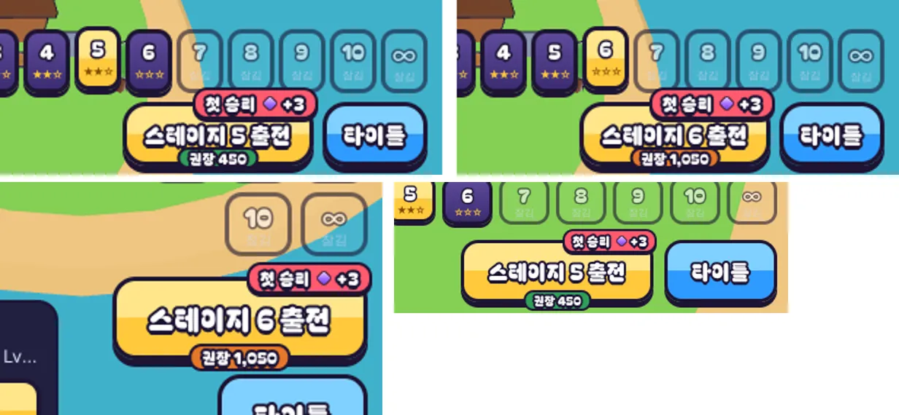

# 89회차: 킹덤 메타, 스테이지 권장 전투력

| 항목 | 값 |
| --- | --- |
| 시각 | 2026-11-13 15:42 ~ 15:55 KST (예약 회차) |
| 기준 | `7f4d1be` (main `f72adce` + 70~88회차) |
| 레인 | 킹덤 메타 (82회차 후보 ‘전투력에 맞춘 스테이지 추천’) |
| 상태 | 완료 |
| 다음 레인 | PvE 콘텐츠 |

## 문제

왕국 전투력(71회차)은 마을 제목 아래 숫자로만 보이고, 어디에도 쓰이지 않는다. 83회차 사다리 목표가 전투력을 목표로 쓰지만, ‘지금 이 스테이지에 나갈 만한가’에는 답하지 않는다. 킹샷식 고리의 기본은 두 가지다.
- 스테이지마다 권장 전투력이 있다.
- 모자라면 마을을 키우러 돌아간다.

지금은 스테이지를 골라도 그 판단을 할 숫자가 없다.

## 범위

- **측정**(스크래치): 균형 성장 경로에서 스테이지마다 지키기 봇(궁수)이 시드 1~8 중 절반 넘게 이기는 가장 낮은 성장 단계를 찾는다.
  - 성장 단계 L에서 성 = 1 + L/2, 강화 다섯 = L/2, 영웅 Lv = 1 + L, 특기 = L/3이다. 상한은 지금 규칙과 같다.
  - 그 단계의 전투력이 권장값이다. 별은 앞 스테이지마다 2개로 셈한다.
- **규칙**(`stages.ts` 또는 `kingdom.ts`): 측정한 값을 다듬어 `STAGE_POWER` 표로 둔다(스테이지 1~10, 오름차순).
- **화면**(`town.ts`, `rush.css`): 출전 단추 아래 가장자리에 작은 알약 ‘권장 1,250’을 둔다.
  - 전투력이 권장 이상이면 초록, 모자라면 주황이다.
  - 화면 읽기 이름에는 ‘권장 전투력 1,250, 지금 980’을 넣는다.
  - 끝없는 도전에는 두지 않는다.
- 시험: 표는 오름차순이고, 첫 스테이지는 새 왕국 전투력 이하다.
- 바꾸는 파일: 규칙 한 곳, `town.ts`, `rush.css`, 시험.

## 가설

측정한 권장값은 스테이지를 따라 오른다. 새 왕국(280)은 스테이지 1 권장 이하다. 스테이지 10은 거의 다 키운 왕국 근처다(끝없는 도전을 뺀 최대 4,970). 알약은 휴대폰 가로·세로에서 일일 보상 배지와 겹치지 않는다.

## 수용 기준

- [x] 스테이지별 성장 단계·승리·전투력 측정 표
- [x] 휴대폰 가로·세로, 데스크톱 마을 스크린샷(권장 이상·미만 두 상태) 직접 확인, 배지·단추와 안 겹침
- [x] `test:rush`, `tsc`, `build`, `smoke:rush` 통과

## 결과

가설이 맞았다. 권장값은 스테이지를 따라 오르고, **스테이지 6에 첫 벽**이 있다.

**측정** (지키기 봇·궁수, 시드 1~8. 괄호는 그 단계의 전투력, 별은 앞 스테이지마다 2개)

| 스테이지 | 단계별 승리 | 처음으로 4/8 이상 | 전투력 | 권장값(50 단위 내림) |
| ---: | --- | ---: | ---: | ---: |
| 1~5 | L0: 8·8·8·8·7 /8 | L0 | 280~480 | 250·300·350·400·450 |
| 6 | L0 0, L1 0, **L2 7** | L2 | 1,070 | 1,050 |
| 7 | L2 2, **L3 8** | L3 | 1,240 | 1,200 |
| 8 | L3 3, **L4 8** | L4 | 1,790 | 1,750 |
| 9 | L4 1, **L5 4**, L6 6 | L5 | 1,880 | 1,850 |
| 10 | L6 3, L7 1, **L8 7** | L8 | 3,050 | 3,050 |

- 스테이지 1~5는 성장 없이 이긴다. 그래서 권장값은 별 몫만큼만 오른다.
- 스테이지 6부터는 성 Lv 2, 강화 각 1, 영웅 Lv 3(L2)이 필요하다. 이 벽이 ‘마을을 키우러 돌아갈 때’다.
- 스테이지 9는 L4→L5 차이가 영웅 Lv +1(전투력 +40)뿐이라 8과 가깝다(1,750 → 1,850).
- 스테이지 10은 L6 3/8, L7 1/8로 들쭉날쭉하다. 시드 8개의 잡음이고, 처음으로 절반을 넘는 L8(7/8)을 택했다. 끝없는 도전을 뺀 최대 전투력(4,970)보다 꽤 아래다.

**규칙** (`kingdom.ts`): `STAGE_POWER = [250, 300, 350, 400, 450, 1050, 1200, 1750, 1850, 3050]`, `recommendedPower(stage)`. 측정 방법은 주석에 남겼다. 시험은 스테이지 수와 같은 길이인지, 오름차순인지, 새 왕국(280)이 스테이지 1 권장 이상인지, 끝없는 도전은 없음(null)인지 확인한다.

**화면** (`town.ts`, `rush.css`)

- 출전 단추 아래 가장자리에 ‘권장 450’ 알약을 둔다. 전투력이 권장 이상이면 초록, 모자라면 주황이다.
- 일일 보상 배지(오른쪽 위)와 겹치지 않는다.
- 화면 읽기 이름: ‘스테이지 6 출전, …, 권장 전투력 1,050, 지금 1,000’.
- 끝없는 도전에는 알약이 없다.
- 휴대폰 가로(높이 420 이하)
  - 단추가 화면 아래 끝에 붙어 있어 알약이 2px 밖으로 나갔다.
  - 그래서 알약을 단추 아래 테두리 위로 올리고(아래 −5px) 글자를 10px로 줄였다. 알약 아래 끝 356, 화면 360이다.
- 전투력 1,000 왕국으로 확인했다(직접 봄).
  - 스테이지 5: 초록 ‘권장 450’
  - 스테이지 6: 주황 ‘권장 1,050’
  - 휴대폰 가로·세로·데스크톱 모두 단추·배지·글자와 겹치지 않는다.
- 새 글자 ‘권’을 글꼴 부분집합에 더했다(`tools/rush-font-subset.py`, 59,164 B, +320 B).

## 검증

- `npm run test:rush`: 106개 통과(새 시험 1개).
- `npx tsc --noEmit`, `npm run build`: 통과.
- `npm run smoke:rush`: 34/34 통과.

## 다음

- **다음 레인: PvE 콘텐츠.** 보호막 주술사 M 넣기(37)다. 진행 시험부터 확인한다.
- 권장값은 지키기 봇 기준이다. 사람 손이 봇보다 낫거나 못하면 실제 체감과 다를 수 있다. 균형을 바꾸면(37 등) 이 측정 스크립트를 다시 돌려 표를 갱신한다(기록의 방법대로).
- 백로그 상위 3개
  1. (PvE 콘텐츠) 보호막 주술사 M(무리 전체 + 근접 넓게 깨기) 넣기, 진행 시험 먼저(37). 넣으면 스테이지 8~10 권장 전투력 다시 재기
  2. (성능·모바일) 영웅 GLB 2단계: 계약 시험을 정규화 읽기로 바꾸고 meshopt(47, 생산 쪽 결정)
  3. (엔진 스파이크) 화면 공간 외곽선 대 뒤집은 껍질 비용 비교(57, 실기기에서 삼각형 병목이 확인될 때)
