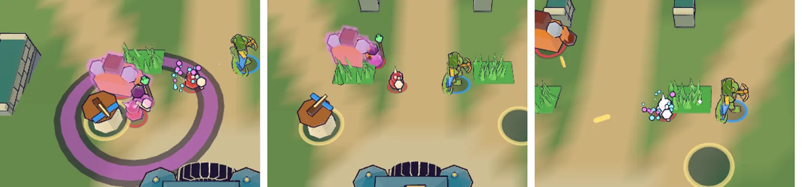

# 90회차: PvE 콘텐츠, 보호막 주술사 넣기(84회차 M)

| 항목 | 값 |
| --- | --- |
| 시각 | 2026-11-13 16:42 ~ 16:58 KST (예약 회차) |
| 기준 | `8a18384` (main `f72adce` + 70~89회차) |
| 레인 | PvE 콘텐츠 (백로그 37) |
| 상태 | 완료 |
| 다음 레인 | 전투 손맛 |

## 문제

84회차에서 보호막 주술사 M이 거르기와 이득을 함께 넘었다. M은 무리 전체에 막을 씌우고, 근접 공격은 둘레 2.5m 막까지 깬다.
- 궁수 다 키운 스테이지 10: 7/8
- 브론: 5/8, 시드 1·2 승
- 포포: 8/8
- 막 우선 사격: 48판에서 +5승, +7별

스테이지 8~10에는 아직 새 판단이 없다. 지금 주술사는 끝없는 도전(스테이지 11~)에만 나온다.

## 범위

- **규칙** (`data.ts`, `sim.ts`)
  - 주술사가 2.5초마다 반경 5m 안의 동료(자신 제외)에게 4초 막을 씌운다(사건 `ward`).
  - 막 쓴 적은 탑 피해를 10%만 받는다.
  - 영웅의 직접 공격(사격·휘두르기·투척·필살)에 맞으면 막이 바로 깨진다(사건 `wardBreak`). 브론의 휘두르기는 맞은 적 둘레 2.5m 막까지 깬다.
  - 주술사는 스테이지 8부터 나온다(`minStage` 11 → 8).
  - **회복은 끝없는 도전에서만 한다**(`heal.minStage` 11). 73회차에서 회복과 막을 함께 쓰면 궁수가 3/8로 떨어졌다.
- **봇** (`bot.ts`): 원거리 영웅은 사거리 안에 막 적이 있으면 가장 가까운 막 적을 먼저 쏜다.
- **보이게** (`render.ts`)
  - 막 쓴 적에는 자홍 반투명 껍질을 씌운다(냉기 껍질 방식, 끝나기 0.25초 전부터 깜빡임).
  - 막을 씌울 때 주술사 둘레에 자홍 고리를 그리고, 깨질 때 자홍 파편을 튀긴다. 글은 쓰지 않는다.
- **시험**: 막 씌우기, 탑 피해 10%, 영웅 공격에 깨짐, 근접 넓게 깨기, 시간 끝나면 풀림, 회복은 스테이지 11부터. 진행 기둥 시험 전부.
- **권장 전투력**: 스테이지 8~10을 `tools/rush-stage-power.ts`로 다시 재서 표를 고친다(89회차).

## 가설

진행 시험이 모두 통과한다. 84회차 숫자대로 궁수 다 키운 스테이지 10은 6/8 이상이다. 영웅 훈련 시험(스테이지 7~8)도 지켜진다. 스테이지 8~10 권장 전투력은 오른다. 휴대폰 가로에서 막 껍질·고리·파편이 보인다.

## 수용 기준

- [x] 보호막 시험과 기존 진행·균형 시험 통과(바뀐 기대값은 근거와 함께 기록)
- [x] 막 껍질·씌우기 고리·깨짐 스크린샷 직접 확인(휴대폰 가로)
- [x] 스테이지 8~10 권장 전투력 다시 재기
- [x] `test:rush`, `tsc`, `build`, `smoke:rush` 통과

## 결과

가설이 맞았다. 보호막 주술사가 스테이지 8부터 나오고, 진행 기둥 시험이 모두 그대로 통과한다.

**규칙** (`data.ts`, `sim.ts`)

- 주술사 `ward: { every 2.5, radius 5, duration 4, towerShare 0.1, meleeBreak 2.5 }`
- 주술사 무리 세 개의 `minStage`를 11에서 8로 바꿨다.
- 회복에 `minStage: 11`을 붙였다. 회복은 끝없는 도전에서만 한다.
- `Enemy.wardT`(남은 막 시간), `wardP`(다음 씌우기까지)를 더했다.
- 사건 `ward`(주술사 자리·반경·몇 명), `wardBreak`(깨진 적)를 더했다.
- 막 처리는 `hurtEnemy` 한 곳에서 한다.
  - 탑 피해는 10%만 들어간다.
  - 영웅·필살 피해는 막을 깬다.
  - 휘두르기 영웅(브론)은 맞은 적 둘레 2.5m 막까지 깬다. 막을 깨는 그 공격의 피해는 그대로 들어간다.
- 84회차 시도 코드와 같은 규칙이다. 다른 점은 막 시간을 줄이는 자리뿐이다. 냉기 시간과 같은 곳, 즉 보스 포효로 건너뛰기 전으로 옮겼다.

**봇** (`bot.ts`): 원거리 영웅(궁수·포포)은 사거리 안의 가장 가까운 막 적을 먼저 쏜다. 막 적이 없으면 전과 같다.

**시험** (`sim.test.ts`, 3개 추가, 1개 조정)

- 막 씌우기
  - 한 주기에 한 번 씌운다. 반경 안 동료는 지속 시간만큼 막을 쓰고, 먼 동료와 주술사 자신은 쓰지 않는다.
  - 스테이지 8에서는 회복이 없다. 주술사가 사라지면 막이 풀린다.
- 탑 피해: 같은 탑, 같은 90스텝에서 막 쓴 브루트가 받는 피해는 정확히 10%다.
- 깨기
  - 궁수 화살은 맞은 적의 막만 깬다(`wardBreak` 사건). 1.2m 옆의 막은 남는다.
  - 브론은 2.4m 뒤 적의 막도 깬다. 그 적은 휘두르기 범위 밖이라 피해를 받지 않았다. 5m 떨어진 막은 남는다.
- 59회차 회복 시험은 스테이지 8 → 11(끝없는 도전)로 바꿨다. 회복이 끝없는 도전 전용이 되었기 때문이다.
- **진행 기둥 시험 전부 통과**: 궁수 다 키운 스테이지 10 ≥ 6/8, 브론 시드 1·2, 영웅 훈련 보상(스테이지 7~8), 영웅 셋 훈련 시험. 기대값은 바꾸지 않았다.

**권장 전투력 다시 재기** (`tools/rush-stage-power.ts 8 9 10`)

| 스테이지 | 89회차 | 이번(주술사 있음) | 단계별 승리 |
| ---: | ---: | ---: | --- |
| 8 | 1,750 | **1,800** | L4 3, L5 7 |
| 9 | 1,850 | **2,450** | L5 3, L6 7 |
| 10 | 3,050 | 3,050 | L6 3, L7 2, L8 8 |

스테이지 9가 가장 어려워졌다(+600). 스테이지 10은 원래 L8이 필요해서 변화가 없다. `STAGE_POWER`를 고쳤다.

**보이게** (`render.ts`, 휴대폰 가로 실제 시연 전투에서 직접 확인)

- 씌울 때: 주술사 둘레 반경 5m 자홍 잉크 고리(0.45초)
- 막 쓴 동안: 적 몸보다 조금 큰 자홍 반투명 껍질(냉기 껍질보다 커서 둘이 함께 보임). 끝나기 0.25초 전부터 깜빡인다.
- 깨질 때: 자홍 파편 6개
- 글은 없다.

## 검증

- `npm run test:rush`: 109개 통과(새 시험 3개).
- `npx tsc --noEmit`, `npm run build`: 통과.
- `npm run smoke:rush`: 34/34 통과.

## 다음

- **다음 레인: 전투 손맛.** 후보는 막 깨짐 소리·진동이다(지금은 화면만). 열린 손맛 항목이 없어 다음 회차에 고른다.
- 백로그 상위 3개
  1. (전투 손맛) 막 깨짐 손맛: 짧은 소리·진동, 브론 넓게 깨기의 한 번에 여러 개 깨짐 강조
  2. (성능·모바일) 영웅 GLB 2단계: 계약 시험을 정규화 읽기로 바꾸고 meshopt(47, 생산 쪽 결정)
  3. (엔진 스파이크) 화면 공간 외곽선 대 뒤집은 껍질 비용 비교(57, 실기기에서 삼각형 병목이 확인될 때)
