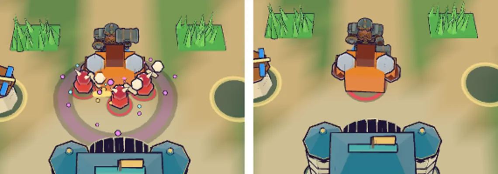

# 91회차: 전투 손맛, 보호막 깨짐 손맛

| 항목 | 값 |
| --- | --- |
| 시각 | 2026-11-13 17:42 ~ 17:53 KST (예약 회차) |
| 기준 | `bb83f8c` (main `f72adce` + 70~90회차) |
| 레인 | 전투 손맛 (백로그 59) |
| 상태 | 완료 (소리·진동은 컨테이너에서 들을 수 없어 코드 경로만 확인) |
| 다음 레인 | 렌더 톤·모델 |

## 문제

90회차 보호막은 깨질 때 자홍 파편 6개만 튄다.
- 소리는 그 공격의 보통 타격음(‘impact’)이라, 막을 깼는지 귀로는 모른다.
- 브론이 한 번 휘둘러 무리의 막을 여러 개 걷어내는 순간이 브론의 역할(84회차 M)을 보여 주는 장면이다. 그런데 하나 깰 때와 똑같이 보이고 들린다.

## 범위

- **요약 함수** (`sim.ts`, 시험 가능): `wardBreakBurst(events)`
  - 한 프레임 사건 묶음에서 막 깨짐 수를 센다.
  - 깨진 자리들의 중심과, 모두를 덮는 반지름을 돌려준다.
  - 깨짐이 없으면 `null`이다.
- **소리** (`main.ts`): 막 깨짐에는 수정처럼 높은 ‘freeze’ 소리를 낸다.
  - 막 깨짐 사건이 타격 사건보다 먼저 오므로, 그 타격의 ‘impact’ 대신 들린다. 공용 소리 제한(전체 50ms, 같은 소리 0.3초)이 연타를 막는다.
  - 공용 `src/lib/sound.ts`는 바꾸지 않는다.
- **진동**: 한 번에 **둘 이상** 깨질 때만 ‘skill’ 진동(22ms)을 준다. 하나씩 깨는 궁수 사격은 진동 없이 둔다(잦은 사격은 조용히, `haptic.ts` 원칙).
- **화면** (`render.ts`): 둘 이상 깨지면 그 무리를 덮는 자홍 잉크 고리를 한 번 더 그린다(0.35초).
- 글은 쓰지 않는다. 바꾸는 파일은 `sim.ts`, `main.ts`, `render.ts`, `sim.test.ts`.

## 가설

귀로도 ‘막을 깼다’가 구별되고, 브론의 여러 개 깨기는 고리와 진동으로 한 번에 읽힌다. 소리 겹침은 공용 제한 안에 머문다.

## 수용 기준

- [x] 시험: 브론 한 번 휘두르기의 요약이 2개 이상과 덮는 반지름, 궁수 한 발은 1개, 깨짐 없으면 `null`
- [x] 실제 전투(휴대폰 가로)에서 브론 여러 개 깨기 고리 스크린샷 직접 확인
- [x] `test:rush`, `tsc`, `build`, `smoke:rush` 통과

## 결과

가설대로 만들었다. 다만 소리와 진동은 컨테이너에서 들을 수도 느낄 수도 없다. 그래서 이 둘은 코드 경로와 공용 제한 규칙으로만 확인했다.

**요약 함수** (`sim.ts`): `wardBreakBurst(events)` → `{ count, x, z, radius }` 또는 `null`. 화면(`render.ts`)과 소리·진동(`main.ts`)이 같은 요약을 쓴다.

**소리·진동** (`main.ts`)

- 막이 깨지면 ‘freeze’를 낸다. 높은 사인 1,800→1,000Hz에 고역 잡음이 섞인 수정 같은 소리다.
  - 이 소리는 사건 반복보다 먼저 울린다. 그래서 같은 프레임의 보통 타격음(‘impact’)은 공용 제한(전체 50ms 간격)에 막힌다. 즉 막을 깬 타격은 타격음 대신 깨지는 소리로 들린다.
  - 같은 소리 0.3초 제한이 있어, 궁수가 연달아 깨도 소리가 겹치지 않는다.
  - 필살 준비도 같은 ‘freeze’를 쓴다(소리 종류를 더하려면 공용 `sound.ts`를 바꿔야 해서 하지 않음). 두 순간은 화면 신호(보라 고리 대 자홍 파편)로 갈린다.
- 진동은 한 번에 둘 이상 깨질 때만 ‘skill’(22ms)이다. 궁수의 한 개 깨기는 진동이 없다. 공용 진동 최소 간격은 200ms다.

**화면** (`render.ts`): 둘 이상 깨지면 깨진 자리들을 덮는 자홍 잉크 고리를 그린다. 반지름은 덮는 반지름 + 1.2이고, 0.35초 동안 보인다.

**시험** (`sim.test.ts`): 깨짐이 없으면 `null`이다. 궁수 한 발은 1개, 반지름 0이다. 브론 한 번 휘두르기는 2개 이상이고, 반지름은 가장 먼 깨짐(1.2m)까지 닿는다.

**실제 전투 확인** (휴대폰 가로, 시연 중 영웅을 브론으로 바꾸고 막 쓴 무리 넷을 둠)

- 한 번 휘둘러 4개가 한 프레임에 깨졌다. 무리를 덮는 자홍 고리와 파편이 보였다(직접 봄).
- 약 0.5초 뒤 고리는 사라지고 막 껍질도 모두 벗겨졌다.

## 검증

- `npm run test:rush`: 110개 통과(새 시험 1개).
- `npx tsc --noEmit`, `npm run build`: 통과.
- `npm run smoke:rush`: 34/34 통과.

## 다음

- **다음 레인: 렌더 톤·모델.** 백로그 60(막 껍질 색 대비)을 새로 적었다. 막 쓴 적이 휴대폰 가로에서 다른 적·잔디와 구별되는지 색 대비(ΔE)로 잰다(74회차 방식).
- 실기기에서 소리·진동 확인이 필요하다(실기기 게이트, 백로그 9).
- 백로그 상위 3개
  1. (렌더 톤·모델) 막 껍질 색 대비 점검(74회차 방식, 잔디·길·다른 껍질과)
  2. (성능·모바일) 영웅 GLB 2단계: 계약 시험을 정규화 읽기로 바꾸고 meshopt(47, 생산 쪽 결정)
  3. (엔진 스파이크) 화면 공간 외곽선 대 뒤집은 껍질 비용 비교(57, 실기기에서 삼각형 병목이 확인될 때)
