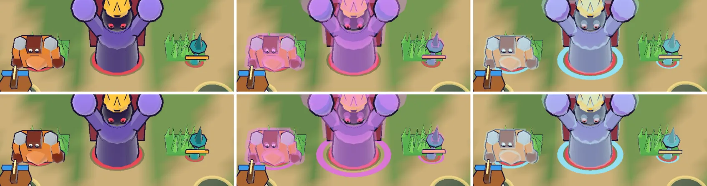

# 92회차: 렌더 톤·모델, 보호막 껍질 색 대비

| 항목 | 값 |
| --- | --- |
| 시각 | 2026-11-13 18:42 ~ 18:56 KST (예약 회차) |
| 기준 | `69e2cee` (main `f72adce` + 70~91회차) |
| 레인 | 렌더 톤·모델 (백로그 60) |
| 상태 | 완료 (껍질 색은 그대로, 막 쓴 적 발밑 자홍 고리를 더함) |
| 다음 레인 | 성능·모바일 |

## 문제

90회차 보호막 껍질(자홍 `0xf08cf0`, 투명도 0.42)은 스크린샷 몇 장으로만 확인했다. 막 우선이라는 판단이 성립하려면 휴대폰 가로에서 세 가지를 한눈에 갈라야 한다. 아직 잰 적이 없다.
- 막 쓴 적과 막 없는 같은 적
- 막 껍질과 냉기 껍질(옅은 하늘 `0xc4f2ff`)
- 막 쓴 적과 바닥(잔디·길)

## 범위

- **측정**(74회차 방식): 같은 장면(영웅 가운데, 적 여섯 종)을 잔디 줄·길 배치 두 판으로 찍는다. 각 판에서 네 장을 찍는다.
  - 빈 화면
  - 막 없음
  - 막 씌움(`wardT` 99)
  - 냉기(`slowT` 99)
- 빈 화면과의 차이로 적 화소만 고르고, 잉크(L < 20)를 뺀 뒤 k-평균 3묶음의 가장 큰 묶음을 주색으로 본다.
- **잴 것**(CIELAB ΔE)
  - 막 쓴 주색 대 바닥. 기준 ≥ 30(74회차)
  - 막 쓴 주색 대 막 없는 주색. 기준 ≥ 15: 막이 씌워졌다는 것이 보이는가
  - 막 쓴 주색 대 냉기 주색. 기준 ≥ 15: 두 껍질이 갈리는가
- **조정**(기준 미달일 때만): 껍질 색·투명도만 바꾼다(`render.ts` `WARD`). 전후를 다시 재고 스크린샷을 직접 본다.

## 가설

자홍은 잔디(초록)와 보색이라 잔디 위 대비는 넉넉하다. 길(모래색) 위와 냉기 껍질 대비도 30 근처일 것이다. 다만 투명도 0.42라 주색이 적 몸 색에 끌려가서, 어두운 적(브루트 갈색)은 ‘막 없음’과의 차이가 작을 수 있다.

## 수용 기준

- [x] 종별·바닥별 세 ΔE 표
- [x] 조정했다면 전후 표와 스크린샷 직접 확인
- [x] `test:rush`, `tsc`, `build`, `smoke:rush` 통과

## 결과

가설과 반대로, 걱정한 적은 갈색 브루트가 아니라 **보라 보스와 자홍 주술사**였다. 몸 색이 자홍 껍질과 가까워서, 막을 써도 주색이 조금만 바뀐다. 바닥·냉기와의 대비는 모든 종에서 넉넉했다. 그래서 껍질 색은 두고, 냉기처럼 **발밑 고리**를 더했다. 몸 색에 기대지 않는 두 번째 신호다.

**처음 측정** (휴대폰 가로, 잔디 줄·길 배치, 보스는 따로 한 판. 단위 ΔE)

| 적 | 바닥 | 막 대 바닥 (≥30) | 막 대 막 없음 (≥15) | 막 대 냉기 (≥15) |
| --- | --- | ---: | ---: | ---: |
| 졸개 | 길 | 61.7 / 59.9 | 33.3 / 36.5 | 29.8 / 30.8 |
| 투척병 | 잔디 | 53.0 / 87.1 | 25.5 / 43.4 | 24.8 / 38.7 |
| 브루트 | 길·잔디 | 59.9 / 80.7 | 63.5 / 48.8 | 33.2 / 29.8 |
| 방패병 | 길 | 71.6 / 61.5 | 40.5 / 37.6 | 48.1 / 42.2 |
| 주술사 | 잔디·길 | 94.0 / 77.3 | **15.7** / 29.5 | 33.7 / 40.8 |
| 보스 | 길 | 73.9 / 76.4 | 26.8 / **12.0** | 30.6 / 31.3 |

- 보스 판에서 보스는 막을 써도 ΔE 12.0으로, 기준 15 아래다. 보라 몸 위의 자홍 껍질이라 얼굴의 어두운 부분만 밝아진다.
- 주술사는 15.7로 기준에 겨우 걸린다. 주술사 둘이 나오는 무리에서는 한 주술사가 다른 주술사에게 막을 씌운다.
- 냉기는 몸 색이 비슷해도 발밑에 하늘색 고리(`frostRing`)가 있어 따로 읽힌다. 막에는 그런 신호가 없었다.

**바꾼 것** (`render.ts`)

- 막 쓴 적 발밑에 자홍 고리(`wardRing`, `0xe070e0`, 투명도 0.9)를 둔다. 반지름은 몸 반지름 × 1.7로, 냉기 고리(× 1.5)보다 넓다. 그래서 둘이 겹쳐도 바깥 자홍과 안쪽 하늘이 함께 보인다.
- 껍질처럼 끝나기 0.25초 전부터 깜빡인다. 묶음 그리기 하나가 늘었다(막 쓴 적이 있을 때만 그림).
- 껍질 색·투명도는 바꾸지 않았다.

**다시 잰 값**

| 적 | 막 대 막 없음: 전 → 후 | 막 대 바닥 | 막 대 냉기 |
| --- | ---: | ---: | ---: |
| 보스(보스 판) | 12.0 → **23.6** | 80.3 | 33.6 |
| 보스(줄 판) | 26.8 → 20.2 | 69.0 | 27.6 |
| 주술사(잔디) | 15.7 → **20.7** | 96.3 | 34.5 |
| 그 밖의 종 | 25~66 | 53.7 이상 | 25.4 이상 |

- 모든 종·바닥에서 세 기준을 넘는다.
- 주색 측정은 묶음 구성에 따라 ±5쯤 흔들린다(보스 줄 판 26.8 → 20.2). 고리는 측정 상자의 아래 끝에 걸려 일부만 세어진다.
- 그래서 판단은 스크린샷으로 했다. 보스·브루트·투척병 모두 발밑 자홍 고리로 막이 바로 읽히고, 냉기의 하늘색 고리와 섞이지 않는다(직접 봄).

## 검증

- `npm run test:rush`: 110개 통과.
- `npx tsc --noEmit`, `npm run build`: 통과.
- `npm run smoke:rush`: 34/34 통과.

## 다음

- **다음 레인: 성능·모바일.** 백로그 61을 새로 적었다. 90~92회차에 더한 묶음 그리기(막 껍질 6종 + 고리)가 무거운 장면의 드로콜에 주는 영향을 다시 잰다.
- 백로그 상위 3개
  1. (성능·모바일) 막 껍질·고리 추가 뒤 무거운 장면 드로콜·삼각형 다시 재기(54·55회차 방식)
  2. (성능·모바일) 영웅 GLB 2단계: 계약 시험을 정규화 읽기로 바꾸고 meshopt(47, 생산 쪽 결정)
  3. (엔진 스파이크) 화면 공간 외곽선 대 뒤집은 껍질 비용 비교(57, 실기기에서 삼각형 병목이 확인될 때)
