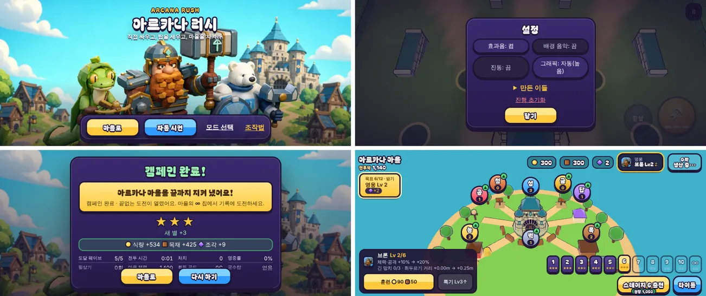

# 94회차: 1.0 완성 (사용자 목표, 2026-11-13)

| 항목 | 값 |
| --- | --- |
| 시각 | 2026-11-13 20:10 ~ 21:00 KST (사용자 목표 회차) |
| 기준 | `2d84698` (main `f72adce` + 70~93회차) |
| 레인 | 전 레인(사용자 목표: 최신 방향·지침대로 게임 완성, Fable·Opus 우선, 필요하면 OpenAI 이미지) |
| 상태 | 완료 — [완성 기준](../completion.md) C1~C10 모두 ✅ |
| 다음 레인 | 1시간 루프 레인 순서대로 이어 감(킹덤 메타) |

## 범위

1.0의 정의를 [completion.md](../completion.md)에 10개 항목(C1~C10)으로 먼저 적고, 독립된 일은 하위 에이전트로 나눴다.

| 일 | 맡은 곳 | 결과 |
| --- | --- | --- |
| C7 진행 속도 | Opus 하위 에이전트 | `tools/rush-campaign.ts`. 새 왕국 → 스테이지 10: 16판·약 60분, 멈춤 0 |
| C4 음악 | Fable 하위 에이전트 | `src/rush/music.ts`. 절차 음악 4분위기 |
| C8 끝없는 도전 균형 | Opus 하위 에이전트 | 시드 64, 회복 비용 −7~10%. 변경 없음 |
| C1·C2·C5 그림 | OpenAI `gpt-image-2`(영웅 렌더를 참고 이미지로) + 렌더 잘라 내기 | 키아트 가로·세로, 앱 아이콘, 영웅 초상 |
| C1~C6 통합, C9·C10 | 본 세션 | 타이틀·설치·설정·음악 연결·초상·엔딩·종단 확인·문서 |

범위 규칙은 하나 넓혔다. 설치 파일(매니페스트·아이콘)은 고정 주소가 필요해서 `public/rush/`에 새 파일로 두었다(loop.md에 기록).

## 결과

- 항목별 근거는 [completion.md](../completion.md) 표에 있다.
- 커밋
  - `1b5088f`: 타이틀·설치·음악 모듈·캠페인 도구
  - `579a4b3`: 설정·음악 연결·초상·엔딩·C8
  - 이번 커밋: README·완성 기록

## 검증

- `npm run test:rush`: 112개 통과(설정 파싱, 음악 악보 시험 추가).
- `npx tsc --noEmit`, `npm run build`: 통과.
- `npm run smoke:rush`: 40/40 통과(타이틀·매니페스트·설정·음악 분위기 검사 추가).
- 빌드본 종단(휴대폰 가로): 새 저장 → 스테이지 1 승리 → 보상 → 성 강화 → 스테이지 2. 페이지 오류 0.
- 직접 본 스크린샷: 타이틀(가로·세로·데스크톱), 조작법 펼침, 설정(가로), 초기화 확인, 캠페인 완료, 마을 영웅 초상(가로·세로).

## 남은 것(사용자 결정·실기기)

- Android 앱 빌드(SDK 라이선스는 사용자 동의가 필요하다), 스토어 출시
- 실기기에서 듣고 만져 보는 확인: 음악·효과음·진동·성능(백로그 9)

## 다음

- 1시간 루프는 레인 순서대로 이어 간다. **다음 레인: 킹덤 메타.**
- 백로그 상위 3개
  1. (킹덤 메타) 목표 7 ‘스테이지 5 별 3개’에서 다시 하기를 알려 주는 안내(캠페인 도구 관찰)
  2. (성능·모바일) 영웅 GLB 2단계: 계약 시험을 정규화 읽기로 바꾸고 meshopt(47, 생산 쪽 결정)
  3. (엔진 스파이크) 화면 공간 외곽선 대 뒤집은 껍질(57, 실기기에서 삼각형 병목이 확인될 때)
