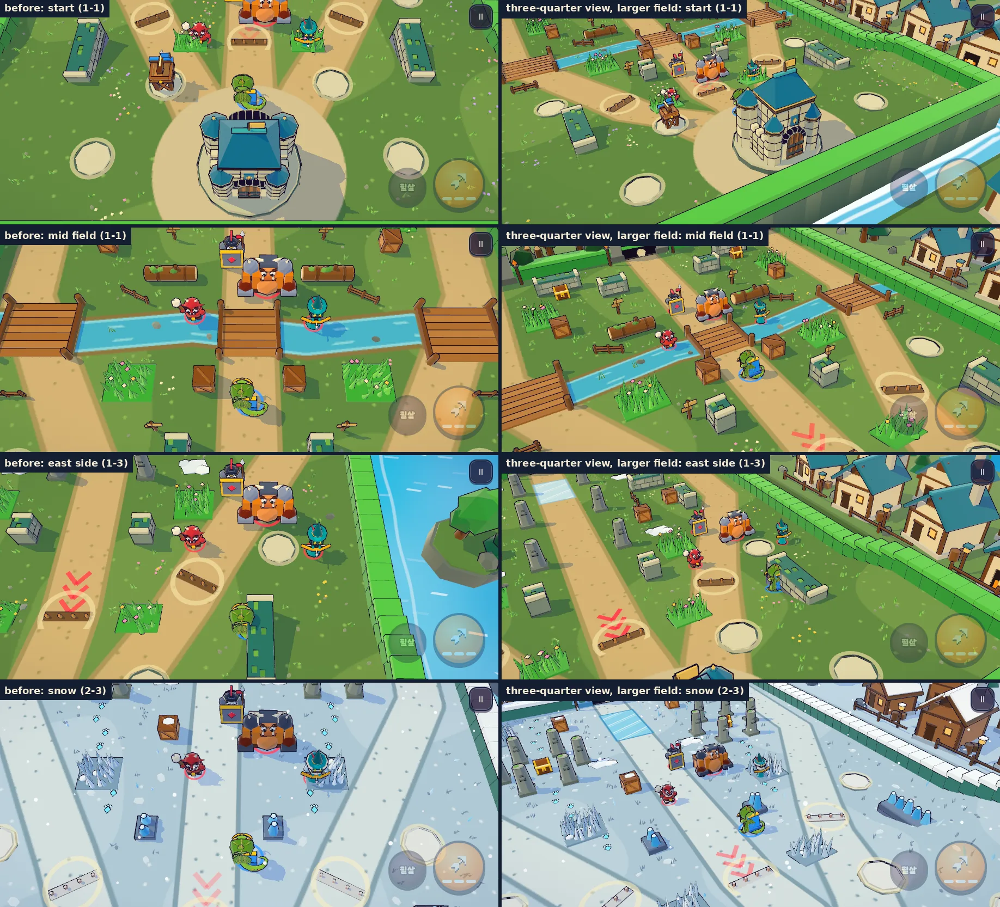

# 3/4 시점 · 전장 60% 확대 · 마을 기슭 (2026-11-16~17, 모델링 세션)

사용자 요청(전장 모델 렌더 한 장과 함께): “이 각도, 맵 넓이 60% 증가, 모델링과 게임 전반(모든 브랜치, 최신 브랜치의 방향성 이어서)의 구성 전반적으로 다 구성해서 완성시키기”.

이 기록은 러시 루프와 다른 세션(`claude/pensive-ptolemy-uhyunb`, 3D 모델링)에서 한 작업이다. 러시 브랜치 `32289bb`까지 병합한 위에 올렸다. 통합판 결정(원정까지 러시로 흡수, 96회차)에 따라 요청을 **러시 전투**에 넣었다.

## 바꾼 것

| 요청 | 구현 | 파일 |
| --- | --- | --- |
| 이 각도 | 전투 카메라가 초점의 **남서쪽**에 선다. 북쪽에서 31도 돌아가고, 지면에서 약 35도 올려다본 3/4 시점이다([전장 모델 렌더](../../arcana-3d-modeling/renders/rt-forest-views.webp)의 각도). 적은 왼쪽 위에서 내려오고 마을은 오른쪽 아래에 있다 | `battleCamera.ts` (`BATTLE_VIEW`, `battleEye`) |
| 조작 | 스틱·방향키·조준 끌기는 화면 방향 그대로다. `screenToGround`가 화면 벡터를 지면 벡터로 돌린다(위 = 화면 위쪽). 마우스 조준은 지면 점이라 그대로다 | `input.ts` |
| 맵 넓이 +60% | 영웅·적·탑을 전장에 대해 1/√1.6(= 0.79)배로 그린다(`MAP_GROWTH`, `MODEL_SCALE`). 전장·길·성벽·탑 자리·마을은 규칙 크기 그대로다. 즉 **전장이 캐릭터 기준으로 넓이 1.6배**가 된다 | `look.ts`, `render.ts` |
| 모델링·구성 | 동쪽과 남동쪽 바다를 **마을 기슭**으로 바꿨다: 물길 건너에 집 10채(대장간 1, 오두막 포함), 울타리, 등불, 나무. 적 관문 옆에는 **진영 목책과 횃불**. 설산은 통나무 집과 눈 지붕이다. 모두 `Part` 조각이라 기존 굽기·잉크 외곽선을 그대로 탄다 | `mapScenery.ts` |
| 모델 시트 | `?sheet=1`은 예전처럼 남쪽 정면에서 본다(줄이 동서로 선다) | `render.ts` |

## 균형은 그대로다

맵을 키우는 방법은 둘이다.

1. **닮은꼴로 키우기(이번 구현)**: 길이가 전부 같은 비율로 커진다. 속도·사거리도 규칙 길이라 함께 커지고, 적 도착 시간(졸개 13.0초)과 권장 전투력이 그대로다. 시뮬레이션 코드는 한 줄도 바꾸지 않았다.
2. **길만 늘리기**: 전장 좌표를 30×39 m에서 38×49 m로 바꾸고 속도는 둔다. 적 도착이 약 26% 늦어지고 영웅이 지킬 땅이 넓어진다. `stages.test.ts`의 기둥 시험과 `STAGE_POWER`를 다시 재야 한다([map-metrics.md](../map-metrics.md)의 ‘전장을 줄이지 않은 이유’와 같은 문제).

1번은 화면에서 “캐릭터가 작아지고 전장이 넓어 보이는” 변화다. 판의 길이와 난이도를 바꾸려면 2번을 따로 결정해야 한다.

## 측정

| 항목 | 이전 | 지금 |
| --- | --- | --- |
| 휴대폰 가로(915×412) 출발점에서 보이는 전장 | 32.6% | **74.4%** (가운데 59.8%, 북쪽 32.3%) |
| 데스크톱 1280×720 출발점 | 38.1% | 85.5% |
| 영웅 화면 키(915×412) | 약 80px | 약 48px |
| 그리기 호출 / 삼각형, 높음 (출발·가운데·북쪽) | 28 / 5.6만 · 23 / 5.0만 · 24 / 4.8만 | 32 / 7.0만 · 36 / 8.7만 · 35 / 8.5만 |
| 같은 값, 낮음 (출발·가운데) | 25 / 3.9만 · 20 / 3.2만 | 29 / 4.7만 · 23 / 3.7만 |
| 주 스레드 프레임 시간, CPU 4배 감속, 적 48 | 12.8 · 18.2 ms (2회) | 12.4 · 21.7 ms (2회). 회차 간 흔들림이 차이보다 크다 |
| 장식 삼각형(맵당, 예산 3.2만) | 1.6만~2.2만 | 2.5만~3.1만 |

- 스틱: 위로 끌면 지면 (0.515, −0.857) 방향(= 화면 위)으로, 아래는 반대로 간다. 좌우는 벽에 닿아 살짝 휜 값(0.76, 0.65)이 나왔다.
- 검증: `test:rush` 152, 전체 `npm test` 781, `tsc`, `build`, `smoke:rush` 42/42.
  - 카메라 시험 3개를 새 시점에 맞게 고치고, 3/4 시점 시험 1개를 더했다.
  - 스모크의 키보드 검사는 “A = 화면 왼쪽(지면에서는 서쪽과 조금 북쪽)”으로 고쳤다.
- GPU 비용은 재지 못했다(소프트웨어 렌더). 실기기 확인이 필요하다.

## 알아 둘 것

- **캐릭터가 화면에서 작아졌다**(약 0.6배). 넓게 보는 대신 치른 값이다. 6분야 작업에서 키운 적 가독성 수치(`tools/rush-contrast.cjs`)는 다시 재지 않았다. 카메라 거리는 `battleCameraPose`의 `height`·`back` 두 숫자다.
- 마을이 화면 오른쪽 아래에 놓여, 출발점에서는 공격·필살 버튼과 가깝다. 버튼이 마을을 가리지는 않는다.
- 서쪽은 예전처럼 바다와 섬이다. 이 시점은 북동쪽을 보므로 서쪽 바깥은 영웅이 서쪽 끝에 갔을 때만 보인다.
- 세로 화면 자세(`height 24`, `back 32`)는 같은 각도로 맞췄지만 화면으로 확인하지 않았다(세로는 가로 전환 안내가 뜬다).

## 사용자 결정 대기

1. 맵 확대를 **닮은꼴(지금)** 로 둘지, **길만 늘리기**로 바꿔 균형을 다시 잴지.
2. 카메라 거리: 지금(전장의 74%가 보임, 영웅 약 48px)과 더 가까운 값(예: 영웅 약 60px) 중 어느 쪽인지.
