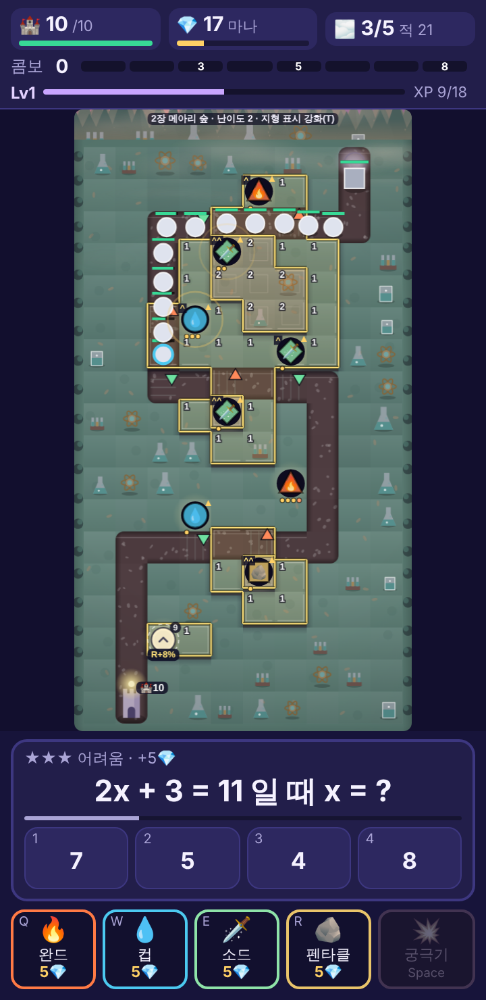
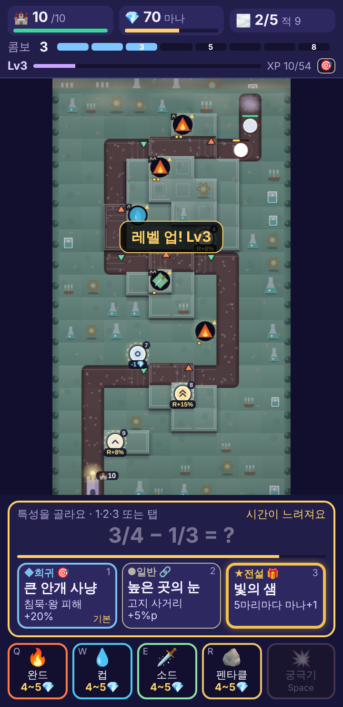
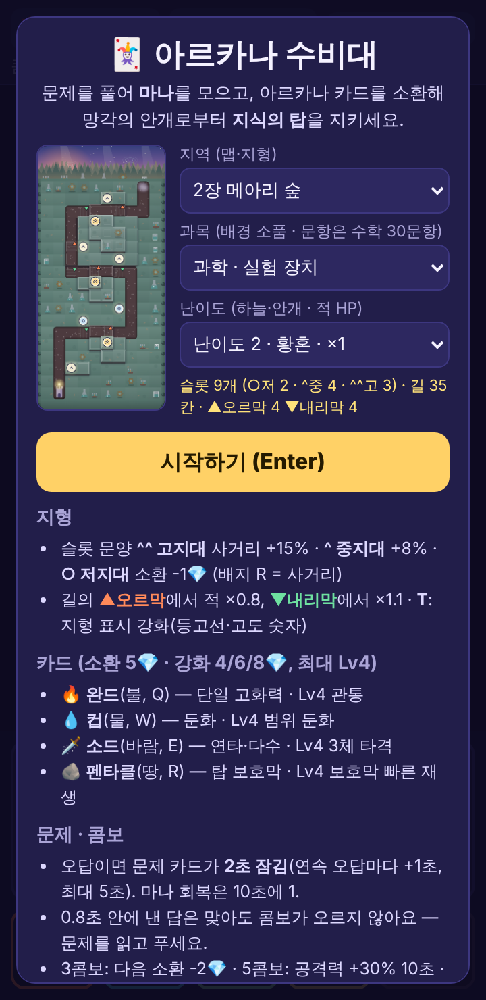
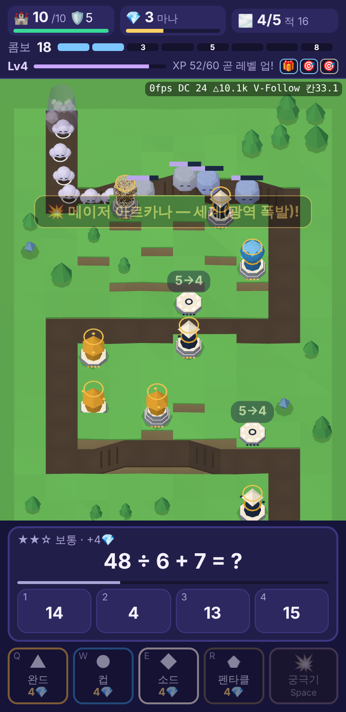
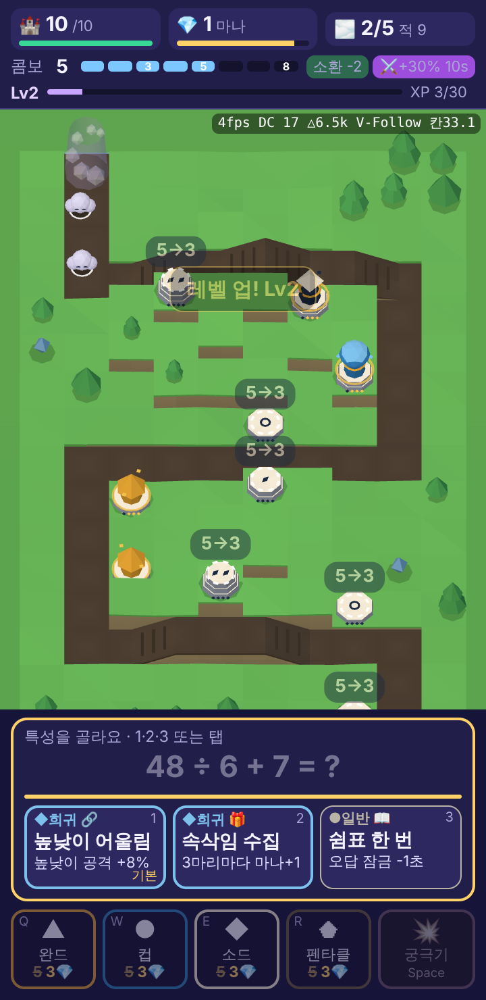
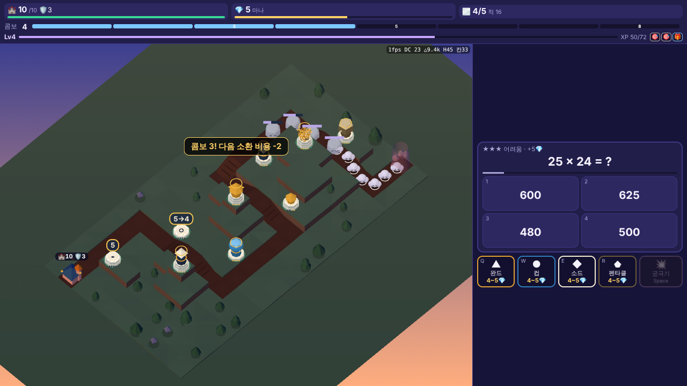

# 아르카나 수비대 — 핵심 루프 프로토타입 (3차)

`index.html` 단일 파일. 외부 네트워크 의존성 없음(폰트·CDN·이미지·사운드 없음). 기준 문서: `docs/arcana-guard/00_brief.md`(§9·§10 추가 요구 포함), `09_traits_perks.md`(판 안 레벨업·특성), `08_environment_terrain.md`(지형·배경), `02_learning_design.md` §5(찍기 억제), `01_core_mechanics.md` §4(콤보)·변경 제안 1(잠금 상한).

  

## 실행
- `index.html`을 더블클릭해 브라우저(Chrome/Edge/Safari/Firefox 최신)로 연다 → 시작 화면에서 **지역 / 과목 / 난이도**를 고르고 **시작하기**(Enter).
- 세로 모바일(360×740) 기준. 데스크톱에서는 가운데 정렬된 360px 폭으로 플레이한다. 맵(10×18 칸)은 화면 높이에 맞춰 비율을 유지한 채 줄어든다.

## 3차 변경점 — 판 안 레벨업·특성 드래프트 (09 문서 로직을 그대로 옮김, 새 기능 없음)
모든 수치는 `BALANCE.xp` · `BALANCE.perk` · `BALANCE.comboResetMode`와 내장 데이터 `PERKS`(= `docs/arcana-guard/content/perks.json` 24개를 내용 그대로 `const PERKS = [...]`로 내장)에서 읽는다.

**A. XP와 레벨업** (09 §1)
- 처치 XP: 안개 조각 1 · 속삭임 2 · 침묵 덩어리 4 · 망각의 왕 10(카드·궁극기 처치 모두, 탑에 닿은 적은 0).
- 정답 XP: 정답 직후 콤보 2~4면 +2, 5 이상이면 +4. **콤보 2 미만 · 읽기 하한(0.8초) 위반 · 회피 · 오답은 0**. 웨이브당 정답 XP 합 ≤ 20. (tf 문항 절반 규칙도 들어 있으나 현재 문항은 4지선다뿐)
- 레벨 비용 Lv n→n+1 = `round(15·n·m)`, m = 지역(장) 배수 1.00/1.20/1.40/1.65. 1장 15/30/45/60/75, 2장 18/36/54/72/90. **Lv6 상한**(이후 XP 막대 `최고 레벨!`).
- **이번 판 정답 3개 전에는 드래프트 보류**(XP 줄에 `정답이 필요해요`), 3번째 정답 직후 연다.
- HUD 세 번째 줄: `Lv` · XP 막대(4px) · `XP 12/30`(85% 이상이면 `곧 레벨 업!`) · 보유 특성 아이콘(계열 아이콘 + 희귀도 테두리, 중첩 `×2`, 콤보 방패).

**B. 드래프트** (09 §2·§5)
- 레벨업 → 월드 시간 ×0.3(적·스폰·카드 쿨다운·마나 회복·버프 전부), 문제 방치·읽기 하한·오답 잠금 타이머 정지, 답 입력 차단. **문제 문장은 그대로**(흐리게) 두고 **답안 버튼 4개 자리에 특성 카드 3장**(희귀도 색·모양 ●/◆/★ + 글자, 계열 아이콘, 이름, 한 줄 효과, 키 번호, 1번 카드 `기본`).
- 3초 막대(방치 막대 자리, 황금색). **3초 초과 → 1번 카드 자동 선택**(`자동으로 골랐어요`). 선택 후 0.3초에 걸쳐 ×1.0 복귀. 입력 가드 0.25초. 연속 레벨업은 1.0초 간격 순차 드래프트(슬로우 유지). 판이 끝나면 남은 XP·드래프트는 버린다.
- 알고리즘은 09 §5 의사코드 그대로: 등장 조건(`requires`) 필터 → 비스택 보유·스택 한도 제외 → `minDraft`(전설은 2번째부터) → 상한 포화(`capRoom` < 0.5) 제외 → 희귀도 70/25/5(남은 희귀도로 재정규화) → 같은 계열 3장 방지 → 왼쪽 = 지금 동작하는 카드 중 `me.std` 최대(동점은 낮은 희귀도). 후보 1장이면 자동 선택, 0장이면 마나 +3.

**C. 특성 효과 적용기** (09 §4·§7.3) — `applyPerks(hook, ctx)` 함수 하나가 `effects[].op` 19종을 모두 처리
- 피해 보너스는 `피해 = 기본 × (1 + k·Σ보너스) × 콤보 버프`, 방어는 그 뒤(갑옷 깎기 반영). `k = min(1, 15/Σeq)`(G1).
- **사거리: 지형 배율 + 특성 가산(C3 +5%p, C6 +3%p) → 총 ×1.20에서 자름**(G2). 예: 고지대 1.15 + C3 0.05 = 1.20, + C6 → 그대로 1.20.
- 처치·학습 마나 특성: **몰입 게이트**(최근 10문항 중 정답 6개 이상, 10문항 미만이면 4문항 이상·60% 이상) + 특성별 `capRun` + 풀 상한(처치 10 · 학습 14) + **특성 마나 판당 합계 20**(G5). 탑 HP 회복 판당 3(G6), 공속 +20%(G7).
- 콤보 방패(B3): 누수 없이 웨이브 정리 → 충전(보유 1, 판당 2회), 오답 시 소모하고 콤보 유지. D2는 몰입 중 늘어난 잠금만 -1초(기본 2초 아래 불가).

**D. 비교용 플래그(기본값 = 현행)**
- `BALANCE.comboResetMode = 'full' | 'half'`(기본 `'full'`). `'half'`는 01 §4대로 **보상 게이지**(3·5·8 보상)만 `floor(g/2)`, 8에 닿은 게이지는 0으로 순환. 연속 정답 수(HUD 콤보 숫자·별·정답 XP·D1)는 오답 시 0.
- 오답 잠금 상한은 기존 키 `BALANCE.quiz.wrongLockMax = 5`(비교값 10, 01 변경 제안 1).
- `BALANCE.perk.enabled = false`면 XP·드래프트가 없는 2차와 같다(시뮬 조건 1).

**E. 결과 화면**: `✨ 이번 판 특성 (LvN · N개 선택)` — 고른 순서대로 희귀도·이름·한 줄 효과, 자동 선택 표시, 특성 마나 합계.

## 2차 변경점
**A. 지형·배경 통합**
- 맵을 `08` 문서/`bg_demo.html`의 **10×18 그리드 맵 4개**로 교체. `bg_demo.html`의 맵 데이터·팔레트·`buildBG`·`buildFog`를 그대로 옮겨 `BG` 모듈로 감쌌다(코드 복사, 수정 없음). 적은 길 칸 중심을 잇는 경로로 이동한다.
- 시작 화면: 지역(1~4) · 과목(수학/영어/과학/한국사, **배경 소품만** 바뀜, 문항은 수학 30문항 공통) · 난이도(1~3 = 이른 노을/황혼/밤 + 적 HP ×0.85/×1/×1.2). 고르면 왼쪽 미리보기와 맵 정보(슬롯 고도 분포, 길 칸 수, 오르막/내리막 수)가 바로 바뀐다. 결과 화면의 **🗺️ 지역·과목·난이도 바꾸기**로 돌아올 수 있다.
- 고도 0/1/2 규칙: 고지대 슬롯 사거리 ×1.08(중)/×1.15(고), 저지대 슬롯 소환 비용 -1(하한 4, 콤보 3 할인과 겹치면 하한 3), 오르막 구간 적 속도 ×0.8 · 내리막 ×1.1(둔화와 곱하고 최종 ≥ 기본의 45%).
- 고도 표시: 배경에 등고선·절벽면·계단선·슬롯 판 문양(○/^/^^)이 들어 있고, 게임 위에 **빈 슬롯 배지**(`-1💎` / `R+8%` / `R+15%`), 소환된 카드 왼쪽 위 고도 문양, 길의 **▲오르막/▼내리막** 표시를 그린다. 슬롯을 누르면 사거리 원이 지형 보너스 반영 크기로 보이고 "높은 곳이라 멀리 봐요 (사거리 +15%)" 같은 문구가 나온다. **T 키** = 지형 표시 강화(고도 틴트·노란 등고선·고도 1/2 숫자).
- 배경(하늘·원경·과목 소품·지면·타일·탑)·안개 스프라이트·지형 오버레이는 (지역, 과목, 난이도, 해상도)가 바뀔 때만 **오프스크린 캔버스에 1회 생성해 캐시**(측정 약 15~30ms). 프레임마다는 `drawImage`(배경 1 + 안개 1~3층×2 + 오버레이 1)와 동적 요소만 그린다. `prefers-reduced-motion`이면 안개 정지.
- 맵마다 길 길이가 34~39칸으로 달라서, 평지 통과 시간이 같도록 적 속도를 길 길이로 정규화했다(`terrain.normalizePathLen`). 경사 효과(×0.8/×1.1)는 그대로 남는다.
- 화면 높이를 맵에 더 주려고 문제 보기 4개를 한 줄(4열)로 바꿨다. 조작·키는 1차와 같다.

**B. 밸런스 v0.3** — 아래 BALANCE 표. 요지: 자동 회복 절반, 오답 잠금 누적, 읽기 하한, Lv4(슬롯당 최대 23마나), 적 HP 가파르게, 웨이브 1~2는 가볍게·3~5는 무겁게.

## 조작
| 동작 | 키보드 | 터치/마우스 |
|---|---|---|
| 지역·과목·난이도 | Tab·방향키(셀렉트) | 시작 화면 셀렉트 |
| 답 고르기 | `1`~`4` (넘패드 포함) | 선택지 탭 |
| 카드 선택 | `Q` 완드 · `W` 컵 · `E` 소드 · `R` 펜타클 | 하단 카드 탭 |
| 소환 | 카드 선택 후 같은 키 한 번 더 → 추천 빈 슬롯(지금 마나로 소환 가능한 첫 슬롯)에 자동 배치 | 빈 슬롯 탭 → 4속성 팝업 → 소환 (카드를 미리 골라 두면 슬롯 탭 즉시 소환) |
| 강화(Lv2~4) | — | 소환된 슬롯 탭 → 팝업의 **강화** |
| 궁극기 | `Space` | 💥 버튼 |
| 지형 표시 강화 | `T` | — |
| **특성 고르기**(레벨업 드래프트 중) | `1` `2` `3` (3초 지나면 1번 자동) · 이 동안 `4`·`Space` 무시 | 카드 탭(확인 버튼 없음) |
| 팝업/선택 취소 | `Esc` | 맵 빈 곳 탭 |
| 시작/다시하기 | `Enter` | 버튼 |

## 규칙 요약
- 탑 HP 10. 적이 탑에 닿으면 일반/빠름 -1, 단단함 -2, 보스 -5(펜타클 보호막이 먼저 흡수).
- 정답 마나 +3/+4/+5(문항 난이도 1/2/3), 자동 회복 **1마나/10초**. 마나 원천은 이 둘뿐.
- **오답**: 마나 없음, 콤보 0, 봉인 등록, 문제 카드 **입력 잠금 2초 → 연속 오답마다 +1초(최대 5초)**, 정답 시 리셋. 잠금 중 카드가 흐려지고(정답 보기만 또렷) 🔒 남은 시간이 표시된다. 소환·강화는 잠금 중에도 가능.
- **읽기 하한**: 문제가 뜬 뒤 0.8초 안에 낸 답은 정답이어도 콤보가 오르지 않는다(마나는 지급, "너무 빨라 콤보 제외" 표시).
- 콤보 3: 다음 소환 -2 / 콤보 5: 전체 공격력 +30% 10초 / 콤보 8: **궁극기 사용권 1개**(콤보가 끊겨도 유지, 최대 1개). 8콤보 주기로 반복.
- 문제 방치 7초부터 테두리 점멸, 10초에 자동 교체 + "회피" 기록.
- 웨이브 5개, 웨이브 전/사이 5초 휴식. 5웨이브: 망각의 왕 + 호위(일반 적이 보스와 동시에 진행).
- **레벨업(3차)**: 처치·정답 XP로 Lv6까지. 레벨업마다(정답 3개 이후) 특성 3장 중 1장, 3초 안에 안 고르면 1번. 특성은 이번 판만(판이 끝나면 초기화).
- 결과: 클리어/함락, 별(★1 클리어, ★2 탑 HP ≥ 6, ★3 정답률 ≥ 80% & 최대 콤보 ≥ 5), 봉인 목록, 해제 퀴즈 1문항(정답 시 다음 판 시작 마나 +3), 다시하기(같은 설정).

## 카드 · 적
| 카드 | 도형 | 역할 | Lv1 → Lv3 | **Lv4 (강화 8)** |
|---|---|---|---|---|
| 완드(불) 🔥 | 삼각형 | 단일 고화력 | 피해 24→62, 1.1→0.9초 | 피해 80, 0.85초, **관통 1**(다음 적에 70%) |
| 컵(물) 💧 | 원 | 둔화 | 피해 5→12, 둔화 35→55% | 피해 16, **범위 둔화**(맞은 적 반경 46 안 모두 둔화+피해) |
| 소드(바람) 🗡️ | 마름모 | 연타·다수 | 피해 7→15, 0.4→0.3초, 2체 | 피해 18, 0.28초, **3체 타격** |
| 펜타클(땅) 🪨 | 사각형 | 탑 보호막 | 보호막 +1 / 12→6초 (최대 5) | 5초마다 + **피격 직후 1.5초 만에 재생** |

사거리는 표의 값 × 슬롯 고도 배율. 적: 안개 조각(원), 속삭임(삼각형, 빠름), 침묵 덩어리(사각형, 방어 3), 망각의 왕(별 모양+👑, 방어 5, 둔화 저항 50%). 적은 흰 외곽선 + 그림자로 배경과 분리(08 문서 A7). 속성·적은 색 + 도형 + 아이콘, 고도는 색 + 문양, 정답/오답은 색 + ✓/✗로 구분.

## 지역(맵) 요약
| 지역 | 슬롯 (저/중/고) | 길 | 오르막/내리막 |
|---|---|---|---|
| 1장 은빛 씨앗 들판 | 10 (5/3/2) | 39칸 | 3/3 |
| 2장 메아리 숲 | 9 (2/4/3) | 35칸 | 4/4 |
| 3장 안개 바다 항구 | 9 (3/4/2) | 34칸 | 1/3 |
| 4장 구름 계단 정상 | 9 (2/3/4) | 38칸 | 2/0 |

## BALANCE (파일 상단 `const BALANCE = {...}`) — 1차 → 2차(v0.3, 잠정값)
| 키 | 1차 | 2차 v0.3 | 이유 |
|---|---|---|---|
| `mana.regenEvery` → `mana.regenSec` | 5초 | **10초** | 방치·찍기의 바닥 수입을 절반으로. 마나 원천을 문제 풀이 쪽으로 더 기울임 |
| `quiz.wrongLockSec` → `wrongLockBase/Step/Max` | 2초 고정 | **2초, 연속 +1초, 최대 5초** (정답 시 리셋) | 0.6초 찍기가 성실 풀이와 비슷한 마나를 벌던 문제(02 문서 5.2). 연속 오답일수록 시간당 기대 마나가 떨어짐 |
| `quiz.readFloorSec` | 없음 | **0.8초** | 표시 직후 제출은 콤보 증가 제외(마나는 지급) → 찍기는 콤보 보상(할인·버프·궁극기)을 못 얻음 |
| `maxLevel`, `cost.upgrade` | 3, [4,6,(8 예약)] | **4**, [4,6,8] | 슬롯당 최대 지출 15 → **23마나**. 1차의 "120마나면 할 일 없음" 해소 |
| `cards.*.lv[3]` | — | Lv4 특수효과(위 표) | 강화 동기 |
| `waves.hpScalePerWave` → `waves.hpMult` | ×1/2/3/4/5 (선형) | **×1/1.6/2.4/3.4/5.0** | 지정값. 초반은 완만, 후반 급경사 |
| `enemies.*.hp` (기본) | 68/40/220/1800 | **130/80/430/3500** (약 ×1.9) | 봇 시뮬로 맞춤: ×1.5에선 보통 HP 8.7·찍기 17% 클리어, ×2.1~2.4에선 보통 클리어 67~83%로 떨어짐 → ×1.95 부근 |
| `waveList` | W1 일반8 / W2 일반8+빠름5 / W3 8+3+6 / W4 빠름8+단단5+일반10 / W5 6+보스+4+6 | W1 **일반6** / W2 **일반6+빠름3** / W3 **일반12**+단단3+빠름6 / W4 **빠름12+단단4**+일반12 / W5 6+보스+단단3+**빠름8+호위 일반10(동시)** | 웨이브 1~2를 가볍게 해 찍기·보통 모두 초반엔 버티고, 풀이량 차이가 웨이브 3~4에서 드러나게. 단단함(-2)을 줄이고 빠름(-1)을 늘려 누수를 덜 계단식으로 |
| `stage.hpMultByDiff` | — | 난이도 1/2/3 = ×0.85/×1/×1.2 | 시작 화면 난이도. 밸런스 기준은 2 |
| `terrain.*` | — | 사거리 ×1/1.08/1.15, 저지대 -1(하한 4, 콤보 할인 겹침 하한 3), 오르막 ×0.8, 내리막 ×1.1, 최종 속도 ≥45%, 길 길이 정규화(기준 1290px) | 08 문서 2절 그대로 |
| 그대로 | | 탑 HP 10, 시작 마나 5, 정답 마나 3/4/5, 소환 5, 콤보 3/5/8(할인 2·버프 1.3×10초), 궁극기 350, 방치 7/10초, 별 기준 | 브리프 고정값 |

## 봇 시뮬레이션 — 특성 4조건 비교 (`tests/bal_sim.js`, 난이도 2, 봇마다 조건당 100판 = 지역 1~4 각 25판)
봇 모델(2차와 같음): 평균 T초(문항 난이도 d에 따라 T×(0.6+0.2d), ±20%)에 확률 p로 정답, 찍기는 0.6초 고정. 일반 `answer()` 경로라 오답 잠금·읽기 하한·지형·특성 규칙을 그대로 받는다. 소비: 슬롯 4개까지 소환, 이후 (다음 소환 vs 가장 낮은 레벨 강화) 중 싼 쪽, 궁극기는 적 5마리 이상 또는 보스. **드래프트가 열리면 답을 멈추고 3초 시간 초과로 1번 카드 자동 선택**을 받는다.

칸 = 클리어율 / 평균 잔여 HP / 평균 레벨업 횟수(= 드래프트 수)

| 봇 | (1) 특성 없음 | (2) 특성 있음 | (3) 특성 + `comboResetMode='half'` | (4) 특성 + `wrongLockMax=10` |
|---|---|---|---|---|
| 우수(3s,90%) | 100% / 10.0 / - | 100% / 10.0 / 4.05 | 100% / 10.0 / 4.05 | 100% / 10.0 / 4.08 |
| 보통(5s,75%) | 84% / 5.7 / - | **93%** / 7.8 / 3.45 | **95%** / 8.3 / 3.44 | **96%** / 8.1 / 3.51 |
| 느림(6.5s,60%) | 6% / 0.3 / - | 17% / 0.7 / 1.55 | 25% / 1.1 / 1.76 | 11% / 0.4 / 1.52 |
| 찍기(0.6s,25%) | 7% / 0.3 / - | **7%** / 0.4 / 0.75 | **9%** / 0.3 / 0.93 | **8%** / 0.3 / 0.75 |
| 방치(답X) | 0% / 0.0 / - | **0%** / 0.0 / 0.00 | **0%** / 0.0 / 0.00 | **0%** / 0.0 / 0.00 |

- 목표 판정: **보통 클리어 ≥ 85%** — 특성 있는 세 조건 모두 충족(93~96%). **찍기·방치 클리어율이 오르지 않을 것** — 방치 0% 유지, 찍기 7% → 7% / 9% / 8%(100판 표준오차 약 ±2.6%p라 유의한 증가 아님. (3)의 +2%p는 재측정 필요).
- 같은 설정 40판 실행에서는 보통 (1) 93% · (2) 88% · (3) 90% · (4) 95%, 찍기 10% / 5% / 5% / 13%로 흔들렸다. 조건 간 차이 대부분이 판 수 노이즈 범위다.
- 특성 유래 마나(판 평균): 우수 6.7~7.9 · 보통 4.9~5.9 · 느림 0.7~1.3 · 찍기 0(몰입 게이트). 상한 20에 한참 못 미친다. 보통의 클리어율·잔여 HP 상승(84%→93%, 5.7→7.8)은 주로 피해형(A·C) 특성 몫이다.
- XP 실측(조건 2, 판 평균 처치/정답): 우수 146/90 · 보통 126/63 · 느림 46/20 · 찍기 32/0 · 방치 2/0. 찍기는 콤보 2 이상을 못 만들어 정답 XP가 0이고, 방치는 정답 3개 조건 때문에 드래프트 0회.
- (3) 콤보 절반 리셋은 보통 궁극기 1.0→2.0회/판(40판 측정), 느림 클리어 17→25%. (4) 잠금 상한 10초는 찍기 클리어율을 낮추지 못했다(7%→8%) — 01 문서 MC의 "1~3%"와 다르다(이 프로토타입의 찍기 봇은 어차피 웨이브 3에서 대부분 함락).

**특성 선택 빈도**(특성 있는 3조건 전체 2,984회, 봇은 항상 1번 = 추천 카드): A1 9.7% · C2 9.5% · B2 8.4% · A4 7.9% · B5 7.3% · A5 7.0% · B4 6.8% · C4 6.5% · D4 6.5% · A3 6.0% · D1 5.1% · B3 5.0% · D6 2.8% · B1 2.3% · C3 2.1% · B6 2.0% · A6 1.9% · C6 1.8% · A2 0.6% · D5 0.5% · D2 0.2% · C1 0.2% · C5·D3 0%. 몰입 게이트 특성(B1·B4·B6·D2·D4·D6)은 몰입이 아닐 때 "지금 동작" 점수가 0이라 1번 자리에 덜 온다.

실행: `cd prototype/tests && node bal_sim.js` (기본 4조건 × 5봇 × 20판). 옵션: `RUNS=100`, `COND=all|1|2|3|4`, 또는 직접 `PERKS=0|1 COMBO=full|half LOCKMAX=5|10`(셋 중 하나라도 주면 그 1조건만), `DIFF=2`, `OV='{"enemies.normal.hp":140}'`, `DUMP=1`. `KEY=VAL`은 환경 변수로도, 명령행 인자로도 줄 수 있다. 100판 × 4조건 × 5봇 실행 약 70초.

<details><summary>2차 시뮬 결과(특성 도입 전, 40판, 참고)</summary>

| 봇 | 클리어율 | 평균 잔여 HP | 함락 웨이브 |
|---|---|---|---|
| 우수(3s,90%) | 100% | 10.0 | — |
| 보통(5s,75%) | 85% | 5.4 | W3×3, W4, W5×2 |
| 찍기(0.6s,25%) | 3% | 0.2 | W2×3, W3×25, W4×11 |
| 방치(답X) | 0% | 0.0 | W2×40 |
</details>

## 테스트 (`tests/proto_test.js`, 27항목 전부 통과)
**3차 추가 8항목**(특성 켬): XP 곡선(2장 18/36/54/72/90) · 정답 XP(콤보 1 → 0, 콤보 2 → +2, 읽기 하한 위반 → 0, 오답 → 0) · 처치 XP(1+2+4) / 레벨업 → 정답 3개 전 보류(`정답이 필요해요`) → 3번째 정답 직후 드래프트 **카드 3장**(희귀도 클래스·●◆★ 글자·키 번호·`기본`), 답안 버튼 숨김, 월드 ×0.3, 문제 타이머 정지, 답 입력 차단 / **3초 초과 → 1번 자동 선택**(3,008ms), ×1.0 복귀 / 입력 가드 안의 `2` 무시 → **`2` 키로 C3 선택 → 사거리 ×1.00/×1.13/×1.20(저/중/고)**, C6 추가 시 ×1.03/×1.16/×1.20(상한) / 드래프트 알고리즘 2,000회(중복 0, 같은 계열 3장 0, 첫 드래프트 전설 0, 비스택 보유·스택 한도 제외, 전설 비율 4.9%) / B6 몰입 게이트(몰입 아님 0마나, 몰입 10처치 +2) · 특성 마나 합계 20 상한 / 비교 플래그 기본값('full', 5초)과 'half'(게이지 7→3, 콤보 0)·잠금 10초(2/4/10/10) / 결과 화면 특성 목록. `screenshot_draft.png` 갱신.

**1·2차 19항목**(특성 끔, 2차와 같은 조건):
시작 화면 셀렉트로 지역 2·과학·난이도 2 선택 → 시작(배경 캐시 키 확인) / 정답 클릭 마나 / 읽기 하한(0.8초 이내 정답은 콤보 0, 이후 정답은 콤보 1) / 오답 잠금(2초, 흐림 필터, 🔒 표시, 잠금 중 입력 무시, 연속 3·4초, 정답 리셋, 상한 5초) / 저지대 슬롯 팝업 소환 4마나 / 팝업으로 Lv4까지 강화(4·6·8마나, '최대 레벨') / 키보드 자동 배치 / 실제 루프 60초 진행(적 이동·방치 교체) / T 토글 / 콤보 3·5·8 보상과 궁극기 사용권 유지 / 결과·해제 퀴즈·다시하기(지역 유지) / 지역 4에서 고도 사거리(88→95.04→101.2)·**기본 사거리 밖·보정 사거리 안 지점에 놓은 적을 고지대 완드만 맞힘**·소환 비용(4/5/5, 콤보 3과 겹치면 3)·오르막 ×0.8 / 지역 1에서 내리막 ×1.1·속도 하한 45% / Lv4 특수효과(소드 3체, 완드 관통 2체, 컵 범위 둔화 4체, 펜타클 피격 후 재생) / BALANCE v0.3 값 / 콘솔 에러 0 · 외부 요청 0. 실행 시 `screenshot.png`(지역 2, 지형 표시 강화)와 `screenshot_start.png`를 갱신한다.

## 테스트 훅
`window.__arcana` — 3차 추가: `PERKS`, `addXP(n)`, `openDraft(ids?)`(레벨업 1회처럼 드래프트를 연다, `ids`로 카드 지정 가능), `pickPerk(i)`(입력 가드 무시), `gainPerk(id)`, `perks`, `xpNeed(lv)`, `inFlow()`, `draftPerks()`, `applyPerks(hook, ctx)`, `slotRangeMult(slot)`. 기존: `state`, `start({region, subject, diff})`, `answer(i)`, `answerCorrect()`, `answerWrong()`, `summon(slot,type)`, `upgrade(slot)`, `useUlt()`, `summonCost(slot)`, `towerRange(slot)`, `enemySpeed(e)`, `wrongLockSec(n)`, `step(sec, dt, draw)`, `slotClientPos(i)`, `SLOTS`·`SEG`·`PATH_LEN`·`SLOT_PRIORITY`·`bgCache`·`terrainStrong`(getter). 밸런싱 봇·자동 테스트용이며 플레이에는 영향 없음.

## 알려진 한계
**3차(특성)**
- **C1 이웃의 힘·C5 물결 오라는 현재 4개 맵에서 효과가 항상 0**: 09 §3.0의 인접(슬롯 중심 거리 ≤ 1.5칸) 쌍이 네 맵 모두 0개다. 등장 조건(`cardCount`, `card`)에는 인접 조건이 없어 "죽은 카드"로 나온다(추천 점수가 0이라 보통 오른쪽 자리). 데이터(`requires`에 인접 조건 추가) 또는 맵 슬롯 배치 쪽 결정이 필요하다 — 이번엔 손대지 않았다.
- **D3·복습 XP 미구현**: 판 중 인라인 복습(02 변경 제안 5)이 없어 `dueSealed`는 항상 거짓 → D3는 후보에서 빠진다(실제 풀 23개). 복습 통과 XP +5도 없다. `manaOnReviewPass` op 자체는 적용기에 들어 있다.
- 09에 있지만 이번 범위 밖이라 넣지 않은 것: 첫 3판 제한 시간 5초, `←` `→` + `Enter` 선택, 카드 길게 눌러 상세 설명(지금은 마우스 `title`만), 접근성 "천천히 고르기", 로그 이벤트(`perk_offered` 등은 `state.picks`·`state.levelLog`로만 남음). 레벨업 배너는 기존 배너 길이(1.6초)를 쓴다(문서 0.4초).
- 카드 크기 약 105×69px(360px 폭)로 09의 108×96px보다 작다(터치 목표 48px는 충족). 드래프트 중 문제 카드가 약 23px 커져 맵 위·아래가 약 11px씩 잘려 보인다(`#stage` overflow 숨김, 재배치·재렌더 없음).
- 해석이 필요했던 곳(문서에 명시 없음): ① 읽기 하한 위반 정답은 특성의 정답 마나(D1·D4·D6)도 주지 않는다(정답 XP와 같은 취급). ② 처치 마나 카운터(B4·B6 "n마리마다")는 몰입이 아닐 때도 세고 지급만 막는다. ③ G1 비례 축소 k는 피해 보너스에만 걸고 속도·사거리·공속에는 걸지 않는다. ④ 특성 피해 보너스는 카드 공격에만 적용하고 궁극기(방어 무시 350)에는 적용하지 않는다. ⑤ `comboResetMode='half'`는 01 §4의 게이지/연속 수 분리를 따랐다(콤보 8 보유 시 마나 +5 같은 01의 다른 규칙은 넣지 않음).
- 찍기 봇 레벨업은 0.75회로 09 §1.3의 예측(3.0)보다 훨씬 적다. 09는 "찍기 봇도 판을 이긴다"는 1차 전제로 계산했지만 2차 밸런스에서 찍기는 웨이브 3에서 대부분 함락되어 처치 XP 자체가 적다(처치 XP 32 vs 09 가정 137). 느림도 1.55회(09 예측 3.15).
- 봇은 항상 1번(추천) 카드를 자동 선택하므로 "사람이 골랐을 때"의 이득 분포(09 §4.4 최적/무작위)는 이 시뮬로 확인되지 않는다.

**2차부터 유지**
- **보통 봇의 결과 분산이 크다**: 평균 잔여 HP는 목표(3~6) 안이지만 판마다 0~10으로 퍼지고 10~17%는 함락(주로 웨이브 3~4). 콤보 보상(특히 궁극기 0~3회)과 문항 난이도 운이 크게 작용한다. 웨이브 4의 "벽"을 더 완만하게 만들거나 펜타클 보호막을 기본 지급하는 식의 완충이 다음 과제.
- **찍기가 웨이브 2에서 함락되는 판이 약 10%**, 드물게 클리어(3~10%)한다. 초반 연속 오답(잠금 5초)이 길게 이어지면 웨이브 2를 못 넘김.
- **우수 플레이어는 여전히 후반에 포화**: 평균 185초에 모든 슬롯 Lv4, 종료 시 약 90마나 남음. 판 길이(약 270초)의 마지막 1/3은 마나 사용처가 없다. 메타 진행·메이저 아르카나 추가 사용처가 필요.
- **느리지만 성실한 학습자(6.5초, 60%)의 수입이 찍기와 비슷**(약 70마나)해서 적 HP만으로는 둘을 가를 수 없다. 난이도 1의 적 HP를 ×0.7로 낮추면 느림 55% 클리어가 되지만 찍기도 33% 클리어한다. 해결은 난이도 적응형 출제(02 문서 3.5)·문항 유형 쪽이 맞다고 보고, 이번엔 ×0.85로 두었다.
- 지역별 차이: 같은 봇이라도 지역에 따라 평균 HP가 1~3 차이 난다(보통: 2장 4.3 ~ 3장 7.0). 지형 최적/최악 배치 효율 차(08 문서 가드레일 T6 ≤12%)는 아직 시뮬레이터로 따로 재지 않았다(봇은 사거리 커버리지 순으로만 배치).
- 맵이 10×18 칸이라 360×740 세로 화면에서 맵 폭이 약 260px(칸 약 25px)로 좁다. 슬롯 터치 판정은 칸 반지름+4로 넓혀 두었다. 문제 보기를 4열 한 줄로 바꿔 높이를 확보했다.
- 과목 선택은 배경 소품만 바꾼다(문항은 수학 30문항 고정). 콘텐츠 팩 로더는 미구현.
- 1차 한계 유지: 사운드·이미지 연출 최소, 일시정지 없음(탭이 숨겨지면 루프 정지), 저장 없음(봉인 목록·해제 보너스·선택 설정은 새로고침 시 초기화), 4지선다만, 카드 판매/재배치 없음, 메이저 아르카나 1종, 키보드만으로 강화 슬롯 선택 불가.

---

## 3D 스파이크 (`3d_spike.html`, 브리프 §14 v0.6)

**목적은 렌더·성능 검증뿐이다.** 마나·문제·콤보·특성 등 게임 로직은 옮기지 않았다(문제 카드·카드 바는 기능 없는 DOM 더미). 2D 프로토타입(`index.html`)은 그대로다.

- 엔진: Three.js r169. `vendor/three.min.js` = npm `three@0.169.0`의 `build/three.module.js`를 esbuild로 IIFE(`window.THREE`) 재번들한 파일(680KB, gzip 약 174KB), 라이선스 `vendor/three.LICENSE`(MIT). r160부터 `three.min.js`가 빠졌고 file://에서는 ES 모듈 import가 CORS로 막혀서 `<script src>`용 빌드를 직접 만들었다. 외부 CDN·폰트·이미지 0.
- 맵 데이터: `bg_demo.html`의 `MAPS`(= 08 문서 3절, 10×18, 고도 0/1/2)를 그대로 복사. 에셋 0(프리미티브 + 버텍스 컬러 + `flatShading`).
- 조정값은 파일 위쪽 `const SPIKE = {...}` 한 곳(그리드 단차 `step: 0.5` = 타일 폭의 0.5배, 길 낮춤 `sink`, 카메라 피치 55°·요 45°·원근 FOV, 지역 4색 세트, 난이도 3단 조명·안개, 적 크기·속도·색, 타워 사거리·스파크 수, 나무 수 등).

### 실행·조작
- `3d_spike.html`을 더블클릭(file://로 열림, 오프라인 동작). 위쪽 조작 막대:
  - **적** 5 / 50 / 200 (InstancedMesh 1개, `count`만 바뀜) · **지역** 1~4(맵 + 지면·절벽·길·나무·배경 색) · **난이도** 1~3(태양색·세기, 반구광, 배경 틴트, 안개 거리)
  - **카메라** 직교 / 원근(FOV 32°) · **요** 45° / 0° (0°는 비교용 추가) · **화면** 세로 360×740 / 가로 1280×720 · **그림자** 켬/끔
- 화면 안 상단 HUD(2D의 HUD 자리): FPS, DC(드로우콜, 그림자 패스 포함), △(삼각형, 그림자 패스 포함), 적 수, 칸(화면에서 타일 한 칸의 가로·세로 변 길이 px).
- 하단: 2D와 같은 자리의 문제 카드(버튼 4개) + 카드 바. 맵은 HUD 아래~문제 카드 위 영역에 **전체가 들어가도록 자동 줌**(`setViewOffset`로 중심을 그 영역에 맞추고 이분 탐색). 가로 화면에서는 문제 카드·카드 바를 가운데 560px 폭으로 둔다(2D는 세로 전용이라 임의 배치).
- 씬 구성: 지형(타일 윗면 + 이웃보다 높은 변만 벽, 맵 가장자리는 치마) 1메시 / 받침대·타워·탑(집+망루)·나무 26그루 병합 1메시 / 적 InstancedMesh / 스파크·흩어짐 파티클 InstancedMesh(최대 1600) / 시작점 안개 기둥(반투명 원기둥 + 안개 덩어리 6개). 빈 받침대 위 비용 라벨은 DOM(카메라가 바뀔 때만 투영, 고도 0은 `◆4` 초록, 나머지 `◆5`).
- 연출: 타워 4기가 사거리 2.6칸 안에서 **가장 앞선 적**에 흰 스파크 7개를 0.22초에 날림 → 명중 시 적이 잠깐 하얗게, 체력 0이면 0.35초 동안 작아지며 같은 색 조각 7개로 흩어짐 → 0.5초 뒤 시작점에서 다시 나옴(적 수 일정 유지). 피·상처 표현 없음.

### 측정 (`node tests/spike_test.js`, 소프트웨어 렌더 기준)
headless Chromium(Playwright 1.63) + `--use-angle=swiftshader --enable-unsafe-swiftshader`, **GPU 없이 CPU로 그리는 SwiftShader**, DPR 1, 안티앨리어싱 켬. 조건: 1장 들판 · 난이도 1 · 직교 · 요 45°. 각 10초 평균(워밍업 1초 뒤, 두 번 실행해 차이 ±1.3FPS 이내). 실제 기기 FPS가 아니라 **상대 비교용**이다.

| 화면 | 그림자 | 적 | 평균 FPS | 드로우콜 | 삼각형 | 최대 프레임(ms) |
|---|---|---|---|---|---|---|
| 세로 360×740 | 켬 | 5 | 27.9 | 10 | 6,453 | 117 |
| 세로 360×740 | 켬 | 50 | 21.5 | 10 | 13,764 | 100 |
| 세로 360×740 | 켬 | 200 | 15.1 | 10 | 37,725 | 133 |
| 세로 360×740 | 끔 | 200 | 20.3 | 7 | 19,024 | 283(토글 직후 셰이더 재컴파일) |
| 가로 1280×720 | 켬 | 200 | 10.1 | 10 | 37,734 | 233 |

- 드로우콜은 적 수와 무관하게 고정(본 패스 7 = 지형·소품·적·파티클·안개 기둥 2(양면 투명)·안개 덩어리, 그림자 패스 3). 삼각형은 적 1마리당 80(그림자 켜면 ×2).
- 콘솔 에러 0, 경고 0, 외부 요청 0(로드된 파일 = `3d_spike.html`, `vendor/three.min.js`).
- 파일 크기: `3d_spike.html` 약 36KB(vendor 제외).

**세로 화면 타일 크기**(같은 테스트가 기록, 2D 프로토타입은 약 25px)

| 카메라 | 세로 360×740 | 가로 1280×720 |
|---|---|---|
| 직교 요 45° | 16×16px | 25×25px |
| 원근 요 45° | 15.5×15.5px | 23×23px |
| 직교 요 0° | 31×25px(가로×깊이) | — |

스크린샷: `3d_spike_portrait_r1_d1.png`(요 45°), `3d_spike_portrait_r1_d1_yaw0.png`, `3d_spike_portrait_r2_d2_persp.png`, `3d_spike_portrait_r3_d3_yaw0.png`(밤), `3d_spike_landscape_r4_d1.png`, `3d_spike_landscape_r1_d2_200.png`(적 200, 원근).

### 알려진 한계·발견
- **세로 + 요 45°는 10×18 맵이 너무 작다**: 마름모로 돌아가 폭이 (10+18)/√2 ≈ 19.8칸이 되어 칸이 16px. 슬롯·적이 2D(25px)보다 작고 터치 목표 48px와 거리가 멀다. 세로를 유지하면 요 0°(칸 31×25px)가 현실적이고, 요 45° 레퍼런스 구도는 가로에서만 성립한다(D13 판단 자료).
- **밝은 베이지 길 위 노란 적의 대비가 낮다**: 08 A3(길↔적 대비 ≥ 3:1)은 "어두운 길 + 밝은 적" 전제였는데 레퍼런스 3D는 길이 밝아 관계가 뒤집힌다. 또 05 8.4는 적을 안개 보라 한 계열로 정했는데 이번 요청은 빨강/노랑이라 충돌 → 적 색·외곽선 규칙 재결정 필요.
- **밤(난이도 3)·4장(눈)에서 읽기 어려움**: Lambert 조명을 받는 적·받침대가 밤에 같이 어두워지고 안개가 대비를 더 깎는다. 적·슬롯은 조명 비적용(언릿)이나 자체 발광이 필요. 4장은 흰 지면 위 흰 절벽이라 단차가 잘 안 보인다(절벽색 대비 규칙 필요).
- SwiftShader에서는 정적 장면만으로 약 27FPS(픽셀 채움·그림자 PCF가 주 비용), 그림자는 적 200에서 FPS를 약 25% 깎는다. 실기기(저사양 안드로이드·iOS) 측정은 아직 없다.
- 직교 요 45°에서는 북·서쪽 절벽면이 보이지 않고, 높은 칸 뒤 슬롯이 가려질 수 있다(가림 검사 없음).
- 길은 칸 단위 사각형(굽이 없음), 적만 꺾이는 칸에서 베지어로 둥글게 돈다. 경사는 "그 칸에 들어설 때 고도가 바뀌는 길 칸"을 기울인 면(08 규칙)이고, 경사 칸이 꺾이는 칸이면 벽으로 메워 약간 어색하다. 오르막·내리막 속도 배율 등 규칙은 넣지 않았다.
- 비용 라벨은 DOM이라 원근에서도 크기가 같고, 화면 비율 바꿀 때만 다시 투영한다. 라벨이 문제 카드 아래로 들어가면 가려진다.
- `vendor/three.min.js`는 전체 빌드(트리셰이킹 없음). 정식 빌드에서는 번들러로 줄인다(12 문서).

---

## 4차: 3D 게임 (`3d_game.html` + `core/sim.js`, 브리프 §16)

2D 3차의 **수비 모드 로직을 그대로** 타일 단위 시뮬 코어로 떼어 내고, 3D 렌더 어댑터와 DOM UI 에 연결했다. 영웅·RTS 는 없다. `index.html`(2D)은 손대지 않았다(동결).

### 구조
```
 입력(탭·키) ─▶ DOM UI ──── run.answer / summon / upgrade / useUlt / pickPerk ────▶ core/sim.js (렌더·DOM 의존 0, UMD)
 (HUD·문제 카드·카드 바·                                                          BALANCE·PERKS 24·MAPS 4·문항 30
  팝업·드래프트·시작/결과)  ◀── snapshot(): 숫자 SoA(적 id·종류·s·x·y·HP·플래그,      10틱/초 고정 step(dt) · 시드 RNG
        ▲                     수호자 종류·Lv) + 이벤트 큐(spawn·beam·kill·leak·…)    타일 좌표 · 지형 규칙 · XP·드래프트·특성 19 op
        │ slotRect·pickTile                    │                                    · 별 · 봉인/해제 퀴즈(세션)
        └──────────── 렌더 어댑터 R(Three.js r169) ◀┘  draw(snapshot, alpha, events) — 읽기 전용, 시뮬로 되돌아가는 경로 없음
```
- `core/sim.js`(약 63KB): `createRun({region, subject, diff, seed, session})` → `step(dt)`(실제 시간을 0.1초 틱으로 나눔, `alpha` = 틱 보간), `answer(i)`, `summon(slot, element)`, `upgrade(slot)`, `useUlt()`, `pickPerk(i)`, `snapshot()`. 브라우저는 `window.ArcanaSim`, Node 는 `require`. 수치는 전부 `BALANCE`(2D 와 같은 값, 길이는 "2D px ÷ 34" 분수로 타일 단위).
- `3d_game.html`(79KB): `vendor/three.min.js` + `core/sim.js` 를 상대 경로 `<script src>` 로 로드(외부 네트워크 0). `VIS` 는 렌더 전용 값(13 문서). 수호자 10은 슬롯마다 메시 1개, 나머지는 인스턴싱 → 드로우콜 22~25.
- 렌더(13 §9 체크리스트): 직교·피치 55°, 세로 = 요 0° **V-Follow**(칸 34px 상한, 선두 적의 행을 따라감, 맵을 **길게 누르면 V-Fit 전체 보기**) / 가로(폭 ≥ 700px) = 요 45° **H45** + 우측 패널 400px. 지형 1메시(윗면 e·0.5T, 길 -0.08T 파임, 경사 = 중심-중심 26.6°, 계단 데칼 3줄, 높이차 > 0.02T 변에 벽), 받침대 8각 저 1·중 2·고 3단 + 윗판 ○/^/^^ + 앞면 Lv 보석 4개, 수호자 ▲원뿔·●구·◆8면체·⬟오각기둥(Lv 높이 0.6/0.7/0.85/1.0T, Lv2 띠·Lv3 공전·Lv4 헤일로), 적 4종(구 3개 / 원뿔+꼬리 / 8각 덩어리 / 큰 구+왕관 5, 반달 눈, 발밑 흰 링+블롭 그림자, 정예·보스·피격 2초 HP 바), 공격 스파크·흩어짐·탑 흡수·보호막 보석·정답 빛기둥·궁극기 링(플래시 0.22/0.12초), 시작점 안개 기둥. **적·받침대·수호자는 조명 무관 재질**(명암을 정점 컬러에 굽기) — 스파이크의 "밤에 적이 안 보임" 해결. 조명은 반구광 1 + 방향광 1(13 §4.3 D1~D3 × 라이트/다크), 그림자 맵·포인트 라이트 없음, 파티클 `Points` 1개 동시 ≤ 60(reduced-motion ×0.4).
- UI 는 2D 3차와 같다: HUD 3줄(탑 HP·보호막·마나·웨이브·콤보 게이지·배지·Lv·XP·특성 아이콘), 문제 카드 4지선다(잠금 흐림·🔒·방치 막대·읽기 하한), 카드 바 Q/W/E/R + 궁극기, 받침대 탭 → 속성 팝업 → 소환 / 소환된 받침대 탭 → 강화(3D 피킹: `pickTile` 레이캐스트 + 최근접 슬롯), 드래프트 3장, 시작 화면(지역/과목/난이도 + 테마), 결과 화면(별·기준·기록·특성·봉인·해제 퀴즈 → 다음 판 +3). 빈 받침대 위 비용 칩(DOM, 받침대 위 0.5T, 저지대·콤보 할인은 `5→4`).

### 실행
- `3d_game.html` 더블클릭(file://, 오프라인). 조작은 2D 와 같다: `1`~`4` 답(드래프트 중 `1`~`3` 특성), `Q/W/E/R` 카드(한 번 더 = 자동 배치), `Space` 궁극기, `Esc` 취소, `Enter` 시작/다시. 맵을 0.38초 이상 누르고 있으면 전체 보기.
- `node prototype/tests/sim_test.js` — Node 만, 약 9초(750판). `REF=1` 이면 2D 기준값(`tests/sim_ref_2d.json`, 20KB)을 Playwright 로 다시 만든다(약 1분). `RUNS=200` 도 가능.
- `node prototype/tests/game3d_test.js` — Playwright + SwiftShader, 약 1분. 스크린샷 3장을 갱신한다.

 



### sim_test 결과 (63항목 전부 통과)
**(a) 2D 3차와 같은 조건의 봇**: `bal_sim.js` 의 봇 5종을 그대로(봇 루프 0.1초, 소비·궁극기 규칙 같음) 2D `index.html` 과 시뮬에서 같은 시드로 돌렸다. 2D 의 `Math.random` 은 호출한 함수 이름으로 시뮬과 같은 세 흐름(문제·봇 / 드래프트 / 특성 확률)에 나눠 줬다. 난이도 2, 봇마다 50판(지역 1~4 번갈아).

| 봇 | 2D 20fps (bal_sim 조건) | **시뮬 4차** | 차이 | 2D/시뮬 잔여 HP | 2D 10fps | compat2D = 2D 10fps 같은 판 | 2D 60fps | 시뮬 + cooldownCarry |
|---|---|---|---|---|---|---|---|---|
| 우수(3s,90%) | 100% | 100% | 0%p | 10.0 / 10.0 | 100% | 48/50 | 100% | 100% |
| 보통(5s,75%) | 92% | 92% | 0%p | 7.7 / 7.7 | 92% | 44/50 | 96% | 96% |
| 느림(6.5s,60%) | 8% | 6% | -2%p | 0.3 / 0.2 | 4% | 44/50 | 14% | 12% |
| 찍기(0.6s,25%) | 12% | 14% | +2%p | 0.6 / 0.7 | 14% | 47/50 | 12% | 18% |
| 방치(답X) | 0% | 0% | 0%p | 0.0 / 0.0 | 0% | 50/50 | 0% | 0% |

- **±5%p 일치**: 기준(20fps = bal_sim) 대비 0/0/−2/+2/0%p, 같은 틱(10fps) 대비 0/0/+2/0/0%p. 200판으로 늘려도 93/13/7% → 92/10/8%(−1/−3/+1%p).
- **같은 입력 → 같은 결과**: `compat2D`(검증 전용: 2D 화면의 고도 들어올림 4px 를 논리 좌표에 재현) 시뮬과 2D 를 같은 0.1초 틱으로 돌리면 **233/250판이 HP·시간·처치·정답·특성까지 똑같다**. 나머지 17판은 "둔화된 적(×0.65)을 뒤 적이 정확히 같은 거리에서 따라잡는" 동점을 px 와 타일의 반올림이 다르게 갈라 생긴다(로직 차이 아님, `tests` 에서 추적 확인). 자동 배치 우선순위도 4개 맵 모두 2D 와 같다.
- (b) 불변식: 방치 0%·전부 웨이브 2 함락·문제 마나 0 / 찍기 최대 콤보 0·정답 XP 0·특성 마나 0·궁극기 0, 함락의 85% 이상이 웨이브 4 이전 / 특성 마나 ≤ 20 / 우수 ≥ 보통 ≥ 찍기 + 50%p / 같은 시드 = 같은 결과.
- (c) 단위: 맵 슬롯 10/9/9/9·경사 3/3·4/4·1/3·2/0·길 39/35/34/38칸, 데이터(문항 30·특성 24·op 19종), 사거리 ×1/1.08/1.15(타일), 소환 4/5(콤보 겹침 3), 오르막 ×0.8·내리막 ×1.1·하한 45%, 길 길이 정규화, 타일 중심 좌표, 잠금 2/3/4/5/5, 읽기 하한, 방치 10초 교체, 콤보 3/5/8, XP 곡선 18/36/54/72/90, **Lv4 행동**(소드 3체·완드 관통 2체·컵 범위 둔화·펜타클 피격 후 1.5초), **특성**: C3 ×1.00/1.13/1.20 · C6 ×1.03/1.16/1.20 · G1 비례 축소 · 방어 깎기 · 속도 · 보스 피해 · 몰입 게이트(B6) · 특성 마나 합계 20 · 탑 회복 3 · 콤보 방패 · 잠금 단축(D2) · 복습 통과 op · 인접 오라 0, 드래프트 2,000회(중복·같은 계열 3장·첫 드래프트 전설·보유 비스택 0), 드래프트 보류→×0.3→입력 가드→3초 자동, 별, 봉인·해제 퀴즈 → 다음 판 +3, 스냅샷 SoA·이벤트 flush, 고정 틱 누적.

### game3d_test 결과 (21항목 전부 통과)
콘솔 에러 0 · 외부 요청 0(로드 파일 = `3d_game.html`, `core/sim.js`, `vendor/three.min.js`) · 시작 화면 셀렉트 4개 → 시작 → **받침대 탭 → 팝업 → 완드 소환(저지대 4마나)** → **정답 클릭 → 마나 +5(DOM)** → 소환된 받침대 탭 → 강화 Lv2 → 키보드(`E` 두 번 자동 배치, `2` 답) → 길게 누르기 V-Fit / 떼면 V-Follow → 웨이브 진행 → **드래프트 3장(답안 자리, ×0.3) → `2` 키로 2번 카드** → 웨이브 3~4 → **결과 화면**(★·기준 3줄·특성 6개·봉인 목록) → 해제 퀴즈 정답 → 다시하기 시작 마나 8 → 가로 H45 진행·받침대 탭 팝업 → 리사이즈 뒤 탭 → 같은 슬롯.

| 화면 | 지역 | 카메라 | 적 | 드로우콜 | 삼각형 | 칸(px) | FPS(SwiftShader) |
|---|---|---|---|---|---|---|---|
| 세로 360×740 DPR2 | 1 | V-Follow | 11 | 24 | 10,092 | 33.1 | 22.3 |
| 가로 1280×720 DPR1 | 2 | H45 | 11 | 23 | 9,364 | 33 | 11.7 |

FPS 는 GPU 없는 소프트웨어 렌더 값이라 상대 비교용이다(스파이크 세로 DPR1 정적 27.9). 드로우콜·삼각형은 12 Level 2 상한(60 / 40k) 안. 화면 오른쪽 위에 `fps DC △ 카메라 칸` 을 띄우고 상한을 넘으면 붉게 바꾼다.

**13 §9 체크리스트 수치**(지역 4개, Lv4 기준 가림 슬롯은 "앞 수호자 꼭대기 − 뒤 길 윗면 > 1.7T", 2장 세로는 13 문서의 (4,3)(4,8)(5,13)과 같다. 해당 슬롯 뒤 길에 적이 있으면 수호자를 알파 0.55 디더로 그린다)

| 화면 | 지역 | 칸(px) | 슬롯 최소 간격(px) | 적 지름(px) | 단차 앞면(px) | 가림 슬롯(Lv4) | 높이 줄인 나무 |
|---|---|---|---|---|---|---|---|
| 세로 V-Follow | 1장 | 33.1 | **42 ⚠** | 23.2 | 9.5 | (3,4) (5,9) | 9 |
| 세로 V-Follow | 2장 | 33.1 | 53.5 | 23.2 | 9.5 | (4,3) (4,8) (5,13) | 9 |
| 세로 V-Follow | 3장 | 33.1 | 63.5 | 23.2 | 9.5 | (3,3) (5,7) (5,12) | 5 |
| 세로 V-Follow | 4장 | 33.1 | 53.5 | 23.2 | 9.5 | (4,4) (3,9) | 8 |
| 가로 H45 | 1장 | 33 | **44.3 ⚠** | 23.1 | 10.3 | (3,4) (5,9) | 9 |
| 가로 H45 | 2장 | 33 | 57.1 | 23.1 | 10.3 | (4,3) (3,5) (4,8) (5,13) (2,15) | 9 |
| 가로 H45 | 3장 | 33 | 70.3 | 23.1 | 10.3 | (3,3) (5,7) (5,12) (4,14) | 5 |
| 가로 H45 | 4장 | 33 | 55.6 | 23.1 | 10.3 | (4,4) (3,9) | 8 |

**WebGL 픽셀 실측**(길 칸 중심·적 몸통 중심을 `readPixels`, 중앙값): 길 상대휘도 0.015~0.055(≤ 0.10), 적↔길 대비 **7.2:1 ~ 10.9:1**(≥ 3:1) — 1·4장 × D1~D3 × 라이트/다크 12조합 모두 통과.

### 2D 3차와 다른 점
1. **좌표**: px → 타일. 2D 는 화면의 2.5D 표현 때문에 고도 1당 논리 y 를 4px(0.12칸) 들어올렸는데, 12 §3.2("고도 투영 오프셋 금지")대로 뺐다. 영향은 자동 배치 우선순위 2곳(1장 마지막 두 슬롯, 3장 첫 슬롯 5↔0)뿐이고 클리어율은 같다(위 표). `compat2D` 옵션은 이 들어올림을 재현하는 **검증 전용** 스위치다.
2. **시간**: 2D 는 프레임 dt(≤ 0.05초) 그대로, 시뮬은 0.1초 고정 틱. 실험 중 발견: **2D 결과가 프레임률에 따라 달라진다**(같은 시드 200판: 보통 93% → 97%, 느림 10% → 20%, 10fps → 60fps). 공격 쿨다운이 끝난 프레임의 남는 시간을 버려서 소드 0.4초가 10fps 에선 0.5초, 60fps 에선 0.417초 주기가 되기 때문이다. 시뮬 기본값은 2D 로직 그대로(= README 밸런스 수치를 낸 bal_sim 20fps 와 같은 결과). `BALANCE.sim.cooldownCarry = true` 면 쿨다운·스폰의 틱 안 남는 시간을 이월해 60fps 2D 와 같은 주기를 낸다(비교 플래그, 기본 false). 플레이 기준을 어느 쪽에 둘지는 다음 밸런스 차수에서 정할 일이다(변경 제안).
3. **난수**: 2D 의 `Math.random` 하나 → 런 시드 하나에서 나온 흐름 3개(문제 순서·봇 / 드래프트 / 특성 확률). 같은 시드·같은 입력이면 같은 판.
4. 연출은 이벤트로: 2D 의 `S.fx`·배너·피드백 문구는 시뮬 이벤트(`banner`, `feedback`, `text`, `beam`, `kill` …)가 되었고 UI·렌더가 소비한다. 문구는 2D 와 같다.
5. UI 차이: 카드 바·팝업 아이콘이 이모지 대신 ▲●◆⬟(13 수호자 실루엣), 빈 슬롯 배지(`-1💎`/`R+8%`) 대신 받침대 위 비용 칩(`5→4`) + 받침대 단 수·윗판 문양, 팝업 사거리 단위가 칸, 휴식 카운트다운은 DOM, `T`(지형 표시 강화)는 없음(3D 가 단차를 직접 보여 줌), 시작 화면에 3D 테마(라이트/다크) 셀렉트 추가·2D 미리보기 캔버스 대신 뒤의 3D 장면, 가로 레이아웃(05 §2.2 우측 패널) 추가.

### 알려진 한계 (3D 에서 생긴 문제)
- **슬롯 간격**: 1장 세로 V-Follow 에서 (5,7)–(5,9) 받침대가 화면에서 **42px**(가로 H45 44px)로 13의 48px 기준 미달. 13 §2.2의 "세로 1.64T" 추정은 고도를 빼고 계산했는데, 뒤쪽 슬롯이 한 단 높으면 화면에서 그만큼 앞으로 당겨진다. 탭은 최근접 받침대가 이기지만 히트 영역이 겹친다. 맵 슬롯 배치(08) 또는 받침대 위치 보정이 필요.
- **가림**: 세로 2~3곳, 가로 2~5곳의 고지대 슬롯이 Lv4 에서 뒤 길의 적을 가린다(표). 디더 0.55 로 처리했지만 가로 2장(5곳)은 많다. 08/13 의 길 가림 규칙(13 변경 제안 2)을 맵 데이터에 반영해야 한다.
- **프레임률 의존**(2D 에서 이어진 문제, 위 2번): 3D 는 고정 틱이라 기기 FPS 와 무관하지만, 2D 의 "60fps 체감 밸런스"와 bal_sim 수치 중 어느 쪽을 기준으로 할지 결정이 필요하다.
- SwiftShader 에서 가로 1280×720 은 12FPS(픽셀 채움 비용). 실기기 측정은 아직 없다. 그림자 맵은 없이 블롭 그림자만.
- 파일 크기 상한(80KB) 때문에 `3d_game.html` 의 렌더 코드는 숫자 인자 공백을 줄여 썼다(79KB). 기능이 더 붙으면 `render/`·`ui/` 파일로 나눠야 한다.
- 13 문서 중 이번에 넣지 않은 것: 원경 링·해/달·별·낮은 안개 카드(L1·L4), 과목 랜드마크(소품 3개로 대체), 지역 예외 연출(등대 등), 정예·보스 반전 외곽선, Lv 별 고유 모델 16종(띠·공전·헤일로 장식으로 대체), 슬롯 선택 시 0.3초 팬, 비용 칩 겹침 축약. 05 의 세로 2×2 선택지 대신 2D 3차의 4열을 유지했다.
- 2D 3차 한계는 그대로다: C1·C5 인접 오라 효과 0(맵에 인접 슬롯 쌍 없음), 판 중 복습·D3 없음, 문항은 수학 30개 고정, 저장 없음(봉인·해제 보너스는 탭을 닫으면 사라짐).
